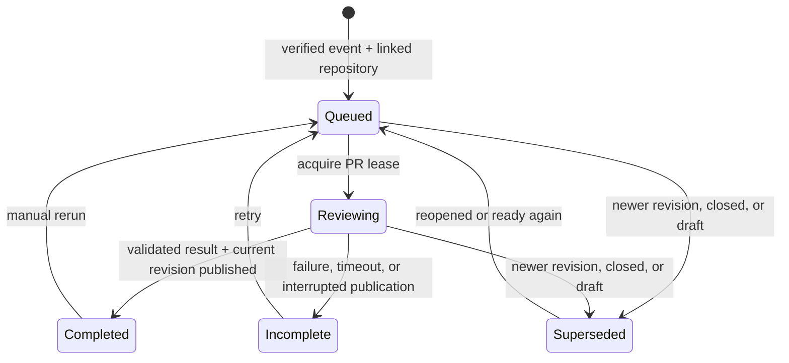

# Production impact reviews: rollout and follow-up

## Current implementation checkpoint — 2026-10-22

The larger agent implementation remains local and has no feature pull request or deployment. Shared table-widget PNG rendering merged in [PR #688](https://github.com/monoscope-tech/monoscope/pull/688) after all required CI checks passed, including the production image build. The independent project wiki merged in [PR #689](https://github.com/monoscope-tech/monoscope/pull/689) as `d8b3bf853ab39006967344bdab2b31972bf9948b`, with all checks green and a captioned walkthrough attached. The installed agent harness uses Pi `1.4.0` and Gondolin `0.13.0`. The server's separate AI library remains the pinned `langchain-hs` `0.0.3.0` fork. These are installed versions, not a claim that they are the latest available releases.

| Area | Implemented locally | Still required |
| --- | --- | --- |
| Impact review | Haskell checkout/supervision, repository instructions and skills, scoped logs/spans/metrics, service knowledge, shared widget PNGs. | Production packaging and Linux deployment validation. |
| Issue fixes | Admission, frozen reproduction, candidate verification, independent review, persisted phases, MP4/diagram/captions, private retention and authenticated download package. Native draft-publication effect is tested separately. | Customer launch UI, application scheduling of fix-PR publication and its authorization/check gates. |
| Project memory | Versioned project wiki with UI, permissions and read/write tools for the four repository-agent roles. | Wiki access for conversational and investigation agents. |
| Usage | Durable model-call starts/receipts, immutable billing attribution, recorded sandbox/check/media resource facts and project/customer views. Missing usage remains unpriced. | Complete per-resource lifecycle records, preparation/storage/transfer attribution and prices, budget reservations, margins and billing. |
| Sandbox reuse | Prepared build caches, private overlays, hash-checked S3 disk checkpoint archive/restore and operator-driven local pruning. | Scheduled maintenance, general orphan reconciliation, remote retention and RAM/process resume. Disk restoration starts a new VM. |
| Haskell migration | Four production prompts, fourteen tool contracts, role-scoped telemetry/wiki dispatch, native candidate Git capture, artifact verification and worker-suite assertions. No worker `*.test.mjs` suites remain. | Remaining fix/VM coordination and native workspace handoff; Haskell replacements for the two research CLIs. The 150–200-line adapter target is not yet achieved. |

After replaying the feature onto `master` at `cb406743c`, the checkpoint integration run passed **25 examples, zero failures, no pending examples**, in 307.822 seconds with seed `478291220`. It exercised the native supervisor, real local microVMs and a deterministic loopback model provider. The retained local log is `scripts/local/master-replay-integration.log`. A full CI sign-off and production deployment have not run.

See [the workflow contract](2026-10-20-issue-fix-workflow.md) for the required product behavior. The dated research and migration notes below preserve evidence from earlier stages; their intermediate test counts and pending-work statements are historical. This checkpoint describes the current state.

### SDK policy migration — 2026-10-22

The application now uses tool pass-through on the existing acknowledged protocol. Haskell supplies role-specific prompts and OpenAPI tool schemas; the child registers SDK tools. Haskell checks the telemetry/wiki tool allowlist, arguments and query budget. There is no new MCP server or HTTP transport. Candidate commit/bundle creation, hashes and synced metadata also run in Haskell against its leased checkout.

Peer review receives the exact regression and binary-safe logs from the existing native artifact verification scope. It no longer clones a second mirror or repeats the verifier in JavaScript. Five replaced modules and four unreachable task branches were removed, along with the direct `proper-lockfile` dependency. Pi still requires that package transitively. The worker README now describes the adapter; the former operational material is preserved in [a dated reference](2026-10-22-agent-worker-operations.md).

The SDK keeps its synchronous receipt spool and `ModelRuntime.streamSimple` gate. Haskell owns replay, attribution, database acceptance and acknowledgement. Removing the local spool before proving crash-safe delivery would risk losing usage already observed by the SDK. Pi catches extension-hook exceptions, so throwing from `before_provider_request` is not an equivalent fail-closed gate.

Verification for this slice: the watcher passed **23 integration examples, zero failures, no pending cases** in 258.345 seconds (seed `478291220`). Candidate/related type boundaries passed 36 focused doctests. Pinned Fourmolu, Node syntax checks and scoped local HLint sign-off passed. The full branch review used the constraint, evasion, locality and distillation skills across three passes; the final pass found no new actionable issue. The retained integration log is `scripts/local/agent-migration-integration-final.log`. Full container/image sign-off for the larger agent branch remains outstanding.

The remaining fix coordination and research commands are explicit follow-ups. The current slice preserves the frozen reproduce → fix → verify → independent-review flow and its metering while reducing JavaScript; it does not complete the whole migration or the production rollout.

The peer-review adapter is also removed. Native verified-artifact capabilities now produce its candidate identity and evidence-file manifest; the common SDK runner handles read-only file placement and host-validated verdict transport. Binary log bytes remain unchanged. Fix coordination, admission VM setup and the two research CLIs still need migration.

### Remaining work and delivery estimate

Estimate recorded 2026-10-22: **3–5 focused engineering days** for the remaining product work with disk-only restoration. Some tasks overlap; Linux sandbox behavior and accounting across crashes are the main uncertainties. This is an estimate, not a completion deadline.

| Work | Estimate | Completion evidence |
| --- | --- | --- |
| Automatic sandbox maintenance | 1 day | Scheduled cleanup respects active leases, recovers orphaned resources and bounds local disk use. |
| Preparation/storage accounting | 1–1.5 days | Immutable project/customer attribution covers preparation, storage and transfer; retries and missing receipts remain explicit. |
| Existing chat-agent memory access | ½ day | Conversational and investigation agents read/write the wiki with current project permissions and recorded authorship. |
| Production packaging and deployment verification | 1–2 days | Provisioned Linux worker runs the workflow, required checks pass, and deployment is verified through the PR process. |

Resuming RAM and running processes is separate: allow another **3–7 engineering days**, potentially longer if the sandbox backend must change. Deliver disk restoration first.

The shared widget PNG PR and [wiki foundation PR #689](https://github.com/monoscope-tech/monoscope/pull/689) are merged. The next wiki changes are sequenced in [the paths/tree and rich-text plan](2026-10-22-project-wiki-followups.md). Keep the larger agent implementation on its checkpoint branch until its integration, packaging and required checks are ready. Run local sign-off before pushing. If a required check cannot run locally, record the unavailable service or tool in the PR and let CI run that check; never attest an unpassed check. Merge only after required checks pass.

The next independent PR is the project wiki (#689): `ProjectMemory`, its existing append-only migrations, repository wiki UI/routes, and HTTP/browser tests. The model uses typed author IDs without importing the agent runtime or billing models. Its tests now live in `Pages.CodeContextSpec` and pass independently (`--match "Project wiki"`: two examples, no failures). Agent tool wiring remains in the larger branch; conversational/investigation-agent memory access still needs implementation. This split does not complete the all-agent memory requirement.

### Chat memory integration boundary

The 2026-10-22 source trace found that `Pkg.AI.AgentAccess.ServiceAccess` carries no requesting identity. Slack access carries a linked user and revalidates that identity, but `Pages.Issues.aiChatPostH` and scheduled routines still start from the service default. Before adding wiki write tools, carry their authenticated user or persisted installation principal into the tool loop, enforce current project edit permission and the existing invocation policy, and persist an explicit assistant author. `ProjectMemory.Agent` identifies a repository-agent attempt; do not coerce a conversation or investigation ID into it. Extend the author sum and append a schema migration for the new author shape. Verify revoked access, viewer reads, rejected writes and concurrent revisions through the real tool loop. This wiring remains unfinished and is excluded from the independent wiki PR.

## Haskell ownership: revised implementation direction

The user's 2026-10-21 direction is to keep JavaScript minimal and the bulk of this feature in Haskell. The JavaScript worker below is a locally tested research prototype, not the target application architecture. Do not add workflow, verification, billing, publication or artifact policy to it. Preserve its behavior/evaluation evidence while moving those responsibilities to the existing typed Haskell effects and models.

The initial prototype inventory had 1,549 lines of application JavaScript across ten files, excluding tests, operator commands (54 lines), and research runners (259 lines). This is a source-line inventory, not a complexity or performance measurement.

| Current worker responsibility | Runtime lines | Haskell ownership |
| --- | ---: | --- |
| Fix, admission and independent-review workflows | 317 | `Pkg.ImpactReview`, `IssueFixes`, and role-specific `CodeReview` tool handlers. Keep phase transitions, frozen artifacts, required-check policy and approval proofs here. |
| Artifact validation, explanation/media, native publication | 433 | Extend `CodeReview`, `AgentArtifacts`, and `GitPublication` interpreters. Invoke Git, FFmpeg, Graphviz and the pinned GitHub CLI through `typed-process`; reuse the shared widget renderer for telemetry charts. |
| Checkout, verification VMs, prepared workspaces, Pi setup | 634 | Haskell owns Git mirrors, preparation identities, cache selection, check orchestration, fingerprints, receipts, limits and cleanup. Only library-specific Pi/Gondolin calls belong at a subprocess boundary. |
| Child protocol, receipt outbox and SDK launch (initial inventory) | 165 | Haskell owns durable delivery, replay, billing attribution and result validation. SDK/CLI event decoding remains a boundary concern. |

**Status 2026-10-22.** All four production roles (advisory, fix, admission, independent review) now run in Haskell-owned VMs (`CodeReview.Guest`). Haskell creates or resumes the VM through `sandbox.mjs`, prepares the role's workspace, serves Pi's read/bash/edit/write calls, and records allocation, checks and phases. Regressions and the fix workflow (`CodeReview.Repair`) are host tool handlers. The production child is `cli.mjs` plus the host branch of `review.mjs`: the Pi session, metering and tool forwarding. By decision, the research runners (`evaluate.mjs`, `reviewbench.mjs`) stay in JS with their own VM path. They take criteria and tool contracts from host policy (`Calibration` for ReviewBench).

### Reuse Pi without a JavaScript application service

[Pi's official CLI integration](https://github.com/earendil-works/pi/blob/main/packages/coding-agent/docs/cli-integration.md) provides bidirectional JSON-lines RPC and uses the same agent/session/context machinery as its interactive application. Haskell can launch the pinned CLI with `typed-process`, send commands and consume events. Completion must wait for `agent_settled`, then validate the result and process exit; prompt acceptance or `agent_end` alone is not completion.

[Pi's built-in MCP support](https://pi.dev/docs/latest/mcp) connects to non-JavaScript tool servers over stdio or Streamable HTTP. Prefer Haskell-owned tools and role policy, rather than another custom JavaScript tool registry. Run Pi in a private control directory so repository `.pi/mcp.json` cannot replace trusted tool configuration. The supervisor prepares sanitized repository instructions/skills and per-job configuration; it must disable built-in host filesystem/shell tools and personal/project extension discovery that could bypass the sandbox. Grant only the intended tools on the server; client-side tool exposure is not authorization.

Monoscope already implements Haskell MCP dispatch and OpenAPI-derived schemas in `Web.MCP`. Reuse its types/authentication patterns, but do not hand the agent the broad public registry: that registry includes writes, and its 30-second tool deadline/notification response is not a proven transport for long verifier jobs. A run/role-scoped server must enforce current project/repository/lease authorization and sandbox access. The [Haskell `mcp-server` library](https://hackage.haskell.org/package/mcp-server) supplies stdio/HTTP transports and derived interfaces if those remove more code than extending the existing endpoint. Source for release `0.3.0.1` was inspected; no new dependency was installed or compiled. Its ADT/schema support must be checked against our existing refined ID and effect types before choosing an integration. DB-aware handlers belong in the root server/worker package; the DB-free `monoscope-cli` must keep its `monoscope-shared`-only dependency boundary.

The intended split is:

```text
Haskell job supervisor, domain types, effects, persistence and costs
  -> upstream Pi CLI: model loop, sessions, compaction, skill discovery
  <- run/role-scoped MCP tool requests -> Haskell handlers
  -> sandbox interpreter -> isolated repository commands and file operations
  -> Haskell evidence, approval, media and publication interpreters
```

Pi remains an upstream Node dependency. This route minimizes our JavaScript while retaining Pi's harness behavior; it does not claim an entirely Haskell dependency graph. [Gondolin's CLI](https://earendil-works.github.io/gondolin/cli/) supports execution, attach, snapshots and resume. However, the installed `0.13.0` CLI's option builder does not expose all the SDK settings we currently require, including `netEnabled: false`, explicit CPU/memory limits and our tmpfs policy. Do not replace the SDK with weaker CLI defaults. Keep only a small explicit SDK adapter for unsupported VM operations, or add/use an upstream interface with equivalent controls. VM lifetime, cache policy, checks and receipts stay in Haskell either way. A direct Firecracker interpreter is a separate Linux backend decision, not a reason to implement application workflows in JavaScript.

### Fully Haskell agent runtime: feasible, but requires parity work

The existing `Data.Effectful.LLM` and `Pkg.AI.runAgenticLoopRaw` already provide a Haskell model/tool loop, scoped tool dispatch, journaling and resume. The original review quality problem did not require a language change: fixed/clipped patches and missing repository execution were harness limitations. A Haskell implementation can give the model the same checkout, instructions, skills and sandbox tools.

The current `langchain-hs` fork is `0.0.3.0` at `ad74fb7f1663349993238d5da99ca05e3bf68334`. Its chat path returns `Message` after discarding the provider response envelope, and the existing application loop estimates token costs. `Pkg.AI.addMessagesToMemory` calls the pinned `TokenBufferMemory.messages` getter; that getter returns the supplied history, so this call does not implement a compaction step. These facts are reasons to preserve measured usage and context behavior during migration, not to expand the JavaScript service.

Upstream [`langchain-hs` 0.0.6.0](https://hackage-content.haskell.org/package/langchain-hs-0.0.6.0/changelog) adds modular providers and graph execution. Its actual Hackage sources also contain `SummaryMemory`, tool tracing and file/process tools. They are useful native building blocks, not proof of Pi-equivalent behavior. The inspected OpenAI provider's non-streaming `invoke` computes `_usage` without returning it; streaming `TokenUsage` has only prompt/completion/total counts. Cached-token breakdown, response identity, interrupted-call reconciliation and compaction-call accounting need a measured provider boundary before it can replace the current usage receipts. The file/process tool implementations operate on the host; their path/security policies are not a microVM backend. Route effects through the sandbox instead of installing those tools unchanged.

An all-Haskell loop is therefore an available longer-term route. The first migration candidate is Haskell orchestration/tools with upstream Pi over RPC/MCP and the small SDK metering boundary described below. Keep the existing server LLM users stable; do not upgrade their shared dependency merely to move filesystem and workflow code out of JavaScript.

### Measured RPC accounting gap and minimal SDK boundary

The application now persists model-call starts in Haskell before the existing SDK transport may contact the provider. `ModelCall` has a distinct typed call ID; correlated usage retains its own delivery ID. Migrations `0246_agent_model_calls.sql` and `0247_agent_model_call_attempt.sql` add immutable starts and a unique call/usage association. Admission, fixing, independent review and advisory review all have a typed start callback. The SDK boundary emits metadata and waits for host acknowledgement; billing policy stays in Haskell. The existing compatibility outbox replays starts before usage and retains rejected/unacknowledged packets.

Run/project/customer totals include started calls without usage as explicitly unpriced. Late usage replaces that pending measurement without adding another call and keeps the attempt's billing snapshot. Correlated receipts must match the same attempt/provider; conflicting delivery or reuse of one call fails. A started attempt cannot accept new receipts with an omitted call ID. Existing legacy receipts remain replayable, including stored JSON that predates the optional field. The server-rendered usage text reports calls without usage separately from attempts without any receipts.

The database and protocol tests cover duplicate starts, missing/late usage, conflicting call identities, cross-project rejection, changed billing customers, legacy replay and account output. The sandbox suite covers durable start delivery, start-before-usage replay and compaction correlation; a separate admission control confirms a rejected start produces no provider request. Verification after the final code edit: the persistent watcher passed ten impact-review examples; the serial nine-test sandbox suite and focused start-rejection control also passed. HLint reported no hints in the affected backend files. This is lifecycle accounting in the current SDK worker, not completed Haskell Pi orchestration. Unknown provider outcomes remain unknown; resource pricing, reservations, margins and actual customer charges remain unfinished.

A local probe of pinned Pi `1.3.0` compared its official CLI RPC output with a synthetic loopback OpenAI-compatible Chat Completions provider. Three ordinary responses, one failed manual compaction and one successful compaction made five provider requests. The provider reported 25,280 tokens; `get_session_stats` reported 20,222. The missing 5,058 tokens belong exactly to the summary that ended with `finish_reason = length`. The failed compaction returned an error and no assistant usage message. Successful compaction exposed aggregate usage, but the final session statistics omitted the failed summary. This is a tested migration constraint; it does not show that the current SDK worker loses these calls.

A second private probe reused Pi's public `createAgentSessionRuntime`, `createAgentSessionFromServices` and `runRpcMode` exports with a small `ModelRuntime.streamSimple` wrapper. It wrote usage-only records to a private, synced journal and reconciled all five responses and all 25,280 tokens, including the failed summary's provider response ID. It added no role/workflow policy, tools, pricing or application JavaScript. All providers, credentials and prompts were isolated synthetic fixtures; no paid model call, VM or customer job ran. Scripts, protocol transcripts and provider-by-provider receipts are under ignored `scripts/local/pi-rpc-metering-20261021/`.

Pi's RPC stdout guard redirects unrelated writes to stderr. A custom SDK wrapper cannot safely add its own accounting frames to RPC stdout, and stderr remains diagnostics rather than a protocol channel. Use a separate private channel for per-call receipts. The probe journal demonstrates visibility, not complete delivery: request-start records, interrupted/unknown usage, stable delivery IDs, replay/acknowledgement, directory syncing, current attribution and cancellation reconciliation still need a Haskell-owned implementation before production adoption. Keep source text, reasoning and credentials out of those receipts.

This changes the migration choice: Haskell supervision/tools with official Pi RPC plus a small SDK-only metering boundary is the first candidate to implement. Plain RPC totals alone are insufficient. A fully custom Haskell provider proxy is not justified merely by this gap when the existing SDK exposes the needed per-call result. Keep the current metered SDK path until a replacement passes the same failed-call/compaction and role-isolation checks.

Two existing self-hosted gateways are also candidates for shared provider accounting. They have not been deployed or passed the five-request fixture here:

| Project | Relevant existing behavior | Qualification |
| --- | --- | --- |
| [LiteLLM](https://docs.litellm.ai/docs/proxy/cost_tracking) | Spend records, request tags and team/user attribution. | Its [pass-through contract](https://docs.litellm.ai/docs/proxy/pass_through_cost_tracking) can record missing/unusable failure cost as zero. Monoscope must preserve unknown usage instead of interpreting every zero as free. The documented [OpenAI capture-rate check](https://docs.litellm.ai/docs/proxy/spend_capture_rate) is marked upcoming, not stable. |
| [Bifrost](https://docs.getbifrost.ai/features/observability/default) | Built-in request logs, token/cost metadata and retry tracking, with [self-hosted deployment](https://docs.getbifrost.ai/quickstart/gateway/setting-up). | The [Apache-2.0 repository](https://github.com/maximhq/bifrost) has separate OSS transport and enterprise releases. Inspect/pin the OSS transport; the latest GitHub release endpoint returned an enterprise tag. The inspected OSS transport is `transports/v2.3.2` at `a05ea20e68bf116a35e9f05b1a3d749624b3935e`. Its [logging plugin](https://github.com/maximhq/bifrost/blob/a05ea20e68bf116a35e9f05b1a3d749624b3935e/plugins/logging/main.go) handles billed usage on errors but can drop asynchronous log entries under pressure or shutdown deadlines. Treat those logs as reconciliation input, not the authoritative billing ledger. Runtime failure/replay/privacy behavior still needs measurement. |

An upstream gateway would keep provider credentials and durable provider receipts on our servers. Haskell must still own project/customer/run/attempt attribution, idempotent reconciliation, budgets, margins and billing snapshots. A gateway's UI is not the product billing ledger. The [official OpenAI streaming contract](https://developers.openai.com/api/reference/resources/chat/subresources/completions/streaming-events) also states that interrupted streams can lack their final usage chunk; no adapter can turn missing provider usage into an exact zero charge.

### Evidence and migration checks

The publication backend now also runs in Haskell through `GitPublication.Native`, using the native recovered checkout, retained media reads, Git and GitHub CLI. The application worker's `PublishTask` role was removed; tokens no longer cross that JavaScript boundary. A separate synced native journal and OS lock preserve interrupted-upload uncertainty. The prototype publication library remains research/test code. The normal authorized DB capability and independent server HTTP readback remain acceptance requirements. Application publication scheduling, check gates, credential selection and metering are still pending.

The application explanation and local-retention paths now also run in Haskell. `CodeReview.Explanation` invokes Git/Graphviz/FFmpeg/FFprobe through `typed-process`; `AgentArtifacts` reads private hash-checked files directly. No application `ExplainFixTask` or `MediaTask` subprocess remains. The native renderer preserves four scenes, inferred-cause labeling, escaped WebVTT, complete media/tool metadata and explicit unpriced resource usage. Content-addressed cache entries are serialized with [`filelock`](https://hackage-content.haskell.org/package/filelock-0.1.1.9/docs/System-FileLock.html), synced and atomically published; every cache hit is checked and corrupt entries regenerate. This replaces application dependence on custom JavaScript, not the pending agent/review/publication migration.

The renderer test first failed without a configured JavaScript worker, then passed with the native implementation. A real local Git/FFmpeg/Graphviz fixture verifies cached reuse, concurrent corrupt-video repair, invalid cached-manifest repair, private media reads, caption escaping and rejected invalid explanation text. The current full impact-review group passes ten integration examples. A retained local preview was probed as H.264, 1280×720, 36 seconds; the diagram/captions were inspected. These are local verification fixtures, not customer jobs or published media.

The first native gate is now `Data.Effectful.CodeReview.Artifacts`: the application verifies private files, frozen execution receipts, SHA-256 digests, Git bundle prerequisites/pack/parent and the patch-derived candidate tree in Haskell before constructing `VerifiedFix`. It uses the existing Git CLI and Haskell dependencies. Explicit usage/cache paths are required. Agent execution, independent review and publication still have JavaScript prototype paths; moving this gate does not complete their migration.

Verification: the long-lived test watcher ran nine production-impact integration examples with no failures. The new missing-artifact test first failed under the child acknowledgement gate, then passed with native verification. A real local Git fixture passes without a configured worker and rejects corrupted metadata, patches, bundles, reports, scripts, logs, symlinks, missing files, invalid report identities/status/result counts, a patch with an updated digest but the wrong tree, and a corrupt pack with an updated digest. Protocol fixtures use the explicit fake interpreter; they do not claim to validate physical artifacts.

The installed Pi `1.3.0` CLI answered RPC `get_state`, `get_session_stats` and `abort` from an isolated non-JavaScript controller. A second probe connected its built-in MCP client to a non-JavaScript stdio fixture and completed `initialize`, the initialized notification and `tools/list`. Both used no custom application JavaScript, model calls, personal credentials, production endpoint or customer jobs. These are transport probes, not a compiled Haskell implementation or a claim that tool execution/cancellation, compaction billing or full review quality has migrated. Private scripts/results and exact Hackage source hashes are under `scripts/local/haskell-harness-research-20261021/`.

The repository-check JavaScript experiment from the same turn was preserved under ignored `scripts/local/candidate-checks-js-prototype/`. Its five application/test files were restored to their exact preceding reviewed hashes; it is not an additional implementation to maintain. The missing candidate-bound full CI/runtime-matrix evidence remains work for the Haskell orchestration path.

Migrate one complete vertical path first: Haskell supervisor -> Pi -> role-scoped Haskell tool -> VM -> immutable receipt -> Haskell approval. Prove a real retained test fails on base and passes on candidate, denied role tools cannot execute, cancellation closes VMs/children, failed/compaction model usage remains attributable, and frozen source/check identities survive restart. Then move artifact/media/publication ownership and delete each replaced JavaScript implementation and test. Preserve the same real-PR controls and shared PNG path for the quality comparison; changing implementation language alone is not evidence of better reviews.

## Review contract

- Every GitHub App repository added through code mappings is eligible by default,
  including mappings without a service. Dashboard sync configuration is not required.
  A shared repository receives a separate, project-labelled comment per project;
  evidence is never combined across projects.
- Signed `opened`, `synchronize`, `reopened`, and `ready_for_review` events queue
  background reviews. Draft and closed events invalidate pending publication.
  Duplicate deliveries reuse a revision run; newer events supersede older work.
  A worker encountering a duplicate lease returns quietly; a newer revision is deferred
  until the active lease expires. Leases last ten minutes for a nine-minute job budget.
- Each review fetches GitHub diff pages for citation validation and clones the exact PR base/head commits for Pi.
  Pi explores source, instructions, skills, callers, and tests in a self-hosted Gondolin microVM.
  The prompt supplies changed-file metadata and seven days of mapped-service event/error aggregates, plus bounded monitor/dashboard references.
  Source patches are not clipped into the model prompt. Missing GitHub hunks produce a citation-coverage gap.
  The agent can query relevant logs, spans, and metrics through scoped read-only KQL, including private event samples. Missing mappings, missing telemetry, and query failures remain explicit coverage gaps. Event samples never become public image snapshots or comment text.
  Service knowledge is recalled and staged through host tools. Completion promotes evidence-linked notes into project/repository/service-scoped PostgreSQL storage; notes retain revision and observation windows and remain dated agent conclusions.
  Agent launch, timeout, and protocol failures leave the run incomplete and retryable, without publishing a comment.
- Model findings must cite a changed line and server-supplied telemetry evidence.
  The server derives the verdict. This release only publishes “Worth checking”,
  “Coverage unknown”, or “No finding”; it does not claim a proven production break.
  Service-level context does not prove a changed-path or deployed-revision match.
- One App-owned summary comment per project is updated in place. Publication rechecks
  the PR head, base, open/draft status, project grant, repository setting, and lease.
  A retry discovers existing App-owned comments by project marker before posting.
  Pure documentation-only revisions complete silently; an earlier comment still
  identifies the revision it reviewed.
- Repositories exposes per-repository review settings under Configure source context,
  with recent results and rerun under Pull requests. Links-only is the default;
  production aggregates require an explicit opt-in. Query text is never rendered in comments.
  Writes require edit permission.
  Links-only comments omit generated production prose, counts, service/environment
  labels, and query text; evidence URLs still identify the linked Monoscope query.



### Enable the GitHub App

1. Run the normal startup migrator to apply all pending migrations. Reviews require
   the review, attempt, usage, and service-knowledge tables.
2. Configure `GITHUB_APP_ID`, `GITHUB_APP_NAME`, `GITHUB_APP_PRIVATE_KEY` (base64 PEM),
   `GITHUB_CLIENT_ID`, `GITHUB_CLIENT_SECRET`, and `GITHUB_APP_WEBHOOK_SECRET` from
   the same GitHub App registration. The secret must match the GitHub App webhook secret;
   dashboard-sync repository secrets are separate.
3. Set the App webhook URL to `/webhook/github` on the public Monoscope host, enable
   pull request events, and grant repository **Contents: read** and
   **Pull requests: read and write**. Existing installations must accept updated
   permissions ([GitHub permission reference](https://docs.github.com/en/rest/issues/comments#create-an-issue-comment)). The App needs access to each source repository added to the project.
4. Set both the App setup URL and user authorization callback URL to
   `<public Monoscope host>/github/callback`, matching `HOST_URL`. Apply migration
   `0220_github_installation_authorization.sql` through the startup migrator.
   Start connections from **Repositories → Add repositories → Connect GitHub account**.
   A project editor who owns the personal account or is an active organization owner
   must authorize the connection. Monoscope verifies the installation with that user's
   access token before sharing the account with the project; the user token is not saved.
   Connection requests expire after 15 minutes and cannot be reused. Direct setup links
   without a request must be restarted from Repositories
   ([GitHub setup URL security](https://docs.github.com/en/apps/creating-github-apps/registering-a-github-app/about-the-setup-url)).
5. Install the [review worker](../../impact-review-worker/README.md) where the server process can execute it.
   Set `IMPACT_REVIEW_AGENT` to its absolute executable path in the server environment.
   Configure the pinned guest image, private usage/cache directories, and the OpenAI
   credentials required by the worker. A configured path alone does not prove runtime
   health. The repository page reports unavailable review setup when the path is unset.
6. Select repositories and link their services under **Configure source context**. Open or
   update a ready PR, then check its review history and GitHub comment. Existing
   open PRs are not backfilled until an event is received.

### Remaining scope

- Automatic repository/service/path and deployed-revision discovery.
- Direct instrumentation-name/attribute continuity proof and service-scoped monitor/dashboard references using parsed query dependencies.
- Latency/metric, issue, trace, endpoint, and deployment evidence beyond service counts.
- Optional GitHub check runs, user feedback, short-lived evidence caching, and retention/cost controls.
- Daily scans, project memory, and on-demand reliability reports.

## Review decisions

- GitHub metadata is read before and after diff retrieval, then before publication.
  These checks prevent concurrent pushes from mixing revisions or publishing stale findings.
- Telemetry reads honor the TimeFusion reader configuration. Postgres remains a temporary
  fallback during the TF migration; the reviewer adds no PG reconciliation path.
- Monitor/dashboard references are project-wide candidates. They do not prove service
  ownership or an instrumentation dependency. Service-scoped matching remains follow-up work.
- Evidence collection has bounded output but no cache yet; dashboard query extraction can
  scan all dashboards in a project. Add caching/indexing when project size warrants it.
- Migration 0214 changes the evidence default without overwriting explicit existing choices.
- The test PEM is generated solely for fake GitHub App JWT tests and is not registered with an App.
- GitHub supplies bounded, potentially truncated patch hunks. The small changed-line reader
  accepts partial hunks; replacing it with a complete-patch parser must preserve that behavior.

## Harness research (2026-10-20)

### Dependency status

The server uses **langchain-hs 0.0.3.0**, with the `openai 2.2.1` client.
`cabal.project` pins our fork at `ad74fb7f1663349993238d5da99ca05e3bf68334`.
That commit adds three fixes above the fork's default branch: embedding encoding,
rate-limit retries, and cancellation propagation.

The [latest upstream release is 0.0.6.0](https://github.com/tusharad/langchain-hs/releases/tag/v0.0.6.0),
published on 2026-10-14 at `470a34de704fc9909173a7bc76191eef23e51123`.
We are **not on the latest upstream release**.
Its [package layout and provider API](https://github.com/tusharad/langchain-hs/blob/v0.0.6.0/README.md)
differ from our imports of `Langchain.LLM.Core` and `Langchain.LLM.OpenAI`.
An upgrade requires a migration across chat, embeddings, tools, and golden interpreters.
A pin change alone is insufficient. Preserve the fork's retry and cancellation behavior during migration.

### What other harnesses provide

| Prior art | Relevant behavior | Gap in the original impact reviewer |
| --- | --- | --- |
| [Pi agent runtime](https://github.com/earendil-works/pi/blob/main/packages/agent/README.md) | Sends tool results back to the model and continues the investigation. | One `callLLM` request cannot ask for missing context. |
| [Pi context management](https://github.com/earendil-works/pi/blob/main/packages/coding-agent/docs/compaction.md) | Summarizes older context while retaining recent messages and file-operation history. | Fixed patch clipping loses context without a retrieval path. |
| [Claude Code workflows](https://code.claude.com/docs/en/common-workflows) | Explores related code and uses commands to investigate and verify changes. | The reviewer cannot inspect callers, tests, or configuration beyond the supplied patch. |
| [PR-Agent diff processing](https://github.com/The-PR-Agent/pr-agent/blob/main/pr_agent/algo/pr_processing.py) | Adds surrounding context, budgets tokens, and records omitted files. | The reviewer uses a fixed 2,000-character limit per patch. |

The app already has a tool loop in `Pkg.AI`; the impact reviewer bypasses it.
That loop also exposes telemetry and project tools with broader data access.
A review needs repository reads pinned to the PR, plus an explicit production-evidence boundary.
Service event counts establish activity, but cannot prove that a changed path runs in production.

### Iteration and acceptance criteria

1. Explore source at the exact PR base and head revisions.
   Implemented: the checkout harness replaces the interim remote source-read loop.
   Repository identity and clone credentials remain outside model control.
2. Use the shared signed widget PNG endpoint for review charts.
   Implemented: cited service charts use `Widget.widgetPngUrl` and `PngSlack`.
   Design changes belong in `web-components/src/chart-png-options.ts`.
   Verify that links-only publication omits chart images and evidence opt-in includes them.
3. Run a checkout-backed review through the existing background job.
   Implemented: the typed CodeReview effect launches the configured Pi/Gondolin executable and exchanges JSON on stdin/stdout.
   Keep logs, spans, metrics, and knowledge behind project-scoped Monoscope tools.
   Record tool failures and exhausted budgets as coverage gaps.
4. Compare the original reviewer, the tool reviewer, and Pi on the same historical PRs and telemetry snapshot.
   Score concrete mechanisms, evidence relevance, false positives, missed incidents, latency, and cost.
   Include renamed signals, changed call sites, sparse telemetry, unrelated monitor queries, and large diffs.
   Model-generated examples alone cannot demonstrate improved production review quality.
5. Migrate the library in isolation, preserving interpreter tests and cancellation guarantees.
   Verify live provider compatibility and deterministic replay before changing the production pin.

The harness provides source search and command execution. Project build toolchains and deployed-path proof remain follow-up work. Scoped logs/spans/metrics investigation and persistent service notes are implemented through host tools.

### Local verification for this iteration

- Server watcher: 146 modules compile successfully.
- Test watcher: all three impact-review integration tests pass.
- Shared PNG renderer: all 19 tests pass under Node 22.23.2.
- Fourmolu, HLint, and diff whitespace checks pass for the changed Haskell files.
- The integration test launches a subprocess through the production effect interpreter.
  It verifies pinned commit/model/credential fields, a finding on file 101, pagination, lease duration,
  coverage propagation, shared chart signing, evidence opt-in, comment replacement, invalid citations, and retry behavior.
- One historical PR revision has now been compared with synthetic telemetry; broader production review quality remains unmeasured.
- Changes remain local; PR sign-off and publication are pending.

## Checkout-backed review direction (2026-10-20)

The user prefers cloning the repository so the reviewer can explore files and read project instructions.
The checkout-backed harness is now connected to the background job. The interim remote source-read loop has been removed.

Primary-source evidence:

- [Claude Code GitHub Actions](https://code.claude.com/docs/en/github-actions) explicitly checks out repositories before code review.
  Its documentation states that checkout provides the local repository for Claude to work in.
- [Codex execution environments](https://learn.chatgpt.com/docs/environments/cloud-environment) document cloning, branch checkout, setup, and cached environments.
  [Codex repository instructions](https://learn.chatgpt.com/docs/agent-configuration/agents-md) describe root and scoped `AGENTS.md` files.
- [Pi SDK](https://github.com/earendil-works/pi/blob/main/packages/coding-agent/docs/sdk.md) accepts a workspace through `cwd`.
  The [resource loader](https://github.com/earendil-works/pi/blob/main/packages/coding-agent/src/core/resource-loader.ts) discovers instruction files.
  Pi supplies file tools, command execution, session management, and context compaction.
  Pi operates on the supplied workspace; repository cloning remains the host application's responsibility.
- [mini-SWE-agent](https://mini-swe-agent.com/latest/faq/) uses a shell-only agent loop.
  Its [environment backends](https://mini-swe-agent.com/latest/advanced/environments/) support local execution, containers, and remote environments.

Proposed Monoscope integration:

1. Resolve the authorized repository and exact PR base/head commits before starting the worker.
2. Use a cached repository and a separate disposable worktree for each review.
   Fetch both pinned commits and enough history to compute the PR merge-base.
3. Run a pinned coding harness in an isolated execution environment with that checkout as its working directory.
   Pi is the first integration candidate because it exposes both an SDK and a language-independent subprocess protocol.
   This choice remains subject to a comparison against the current reviewer on real PRs.
4. Load repository instructions, then let the harness search source, inspect callers and tests, and run relevant checks.
   Treat PR changes to instruction files as review material; they cannot grant credentials or publication authority.
5. Supply Monoscope telemetry through project-scoped tools. Keep clone credentials and production credentials outside repository command execution.
6. Return structured findings and the investigation transcript to the server.
   Keep changed-line/evidence validation, revision freshness checks, comment publication, and shared widget PNG rendering in Monoscope.

Checkout alone does not establish better reviews. Verification must measure useful findings, false positives, evidence quality, latency, and cost.
The intended advantage is a complete workspace plus iterative investigation and verification through an established harness.

## Self-hosted sandbox reuse (2026-10-20)

The user requires the harness, sandbox, and tools to run on our servers. Managed sandbox services are excluded.
The existing background job should own review scheduling; this does not require a separate impact-review HTTP service.
The initial local Docker prototype proved pinned checkout exploration and instruction loading.
It has been replaced with a Pi + Gondolin microVM prototype; this does not establish a production sandbox choice or better review quality.
Bundled and automatic repository skill loading are implemented. Monoscope CLI access and project test toolchains remain unwired.

Reuse candidates:

| Project | What we can reuse | Tradeoff |
| --- | --- | --- |
| [Pi](https://github.com/earendil-works/pi/blob/main/packages/coding-agent/docs/sdk.md) | Agent loop, tools, skills, sessions, context management | We supply repository authorization, workspace, and project-scoped telemetry tools. |
| [Gondolin](https://github.com/earendil-works/gondolin) | Self-hosted microVM lifecycle, filesystem policy, network mediation, and credential injection | QEMU by default, experimental libkrun backend; not Firecracker. Its [Pi integration](https://github.com/earendil-works/gondolin/blob/main/host/examples/pi-gondolin.ts) already redirects repository tools into the VM. |
| [OpenSandbox](https://github.com/opensandbox-group/OpenSandbox) | Sandbox lifecycle/execution SDKs, network policy, credential vault, reusable agent environments | Its [Fast Sandbox Firecracker integration](https://github.com/opensandbox-group/OpenSandbox/blob/main/docs/architecture/fast-sandbox/index.md) uses Kubernetes, node runtime agents, and template pools. More infrastructure than an embedded library. |
| [Kata Containers](https://github.com/kata-containers/kata-containers/blob/main/docs/how-to/how-to-use-kata-containers-with-firecracker.md) | Existing containerd integration for Firecracker-backed containers | Supplies the execution runtime; we still need review orchestration and sandbox lifecycle integration. |
| [Microsandbox](https://github.com/superradcompany/microsandbox) | Local embeddable microVMs, OCI images, snapshots, SDKs | The project labels itself beta. Assess command execution, cleanup, resource limits, and credential boundaries before adoption. |

Evaluate Pi + Gondolin first when hardware-isolated microVMs satisfy the requirement; use the upstream integration instead of writing a VMM controller.
If Firecracker is required, evaluate an existing OpenSandbox/Kata deployment before building another sandbox service.
Gondolin's [custom image guide](https://github.com/earendil-works/gondolin/blob/main/docs/custom-images.md) supports Debian/Ubuntu OCI userspace with an Alpine boot layer; its limitations page's "Only Alpine" statement does not describe that userspace option.
Verify the actual compiler and Monoscope CLI image rather than assuming compatibility.

Bundle applicable review/KQL skills explicitly. Embedded Pi sessions do not inherit this Codex session's tools, connectors, or skill installation.
Keep production credentials outside repository commands and provide read-only, project-scoped telemetry through a trusted adapter.
Retain evidence validation, revision checks, publication, and the shared widget PNG renderer in Monoscope.
Daytona's [public repository notice](https://github.com/daytonaio/daytona/blob/main/README.md) says it became unmaintained in June 2026; it is not the preferred new self-hosted dependency.

Local prototype verification:

- Pi 1.4.0 and Gondolin 0.13.0 are pinned in `impact-review-worker/package-lock.json`.
- Gondolin's image builder created a Debian OCI userspace with Git, Bash, and ripgrep.
- The SDK integration test passes with Gondolin's native libkrun runner on this Mac: pinned base/head, root instructions, explicit skill discovery/read, source search, repository check, absent host credentials, and read-only host mounts.
- Both normal completion and cancellation during a running shell command terminate the runner process and remove the session.
- Committed `.agents/skills` and `.pi/skills` appear in Pi's skill catalog and resolve to guest paths. Metadata comes from regular Git blobs; repository directory/file symlinks cannot redirect the host loader. The regression test failed before discovery was added and passes after it.
- Truncated shell output remains readable through both guest read and shell tools. The regression test first failed because Pi advertised a host-only temporary path. The adapter now streams complete output into the guest and removes the host copy; the test verifies both reads and host cleanup.
- The installed QEMU 7.2.0 binary has no `hvf` accelerator; its boot failed. Linux/KVM and native macOS QEMU remain unverified.
- The unused review HTTP service was removed. The Haskell background job calls the JSON stdin/stdout entry point through CodeReview, with production and deterministic test interpreters.
- The subprocess test uses Pi's real OpenAI-compatible transport against a deterministic model endpoint on this host. It loads a trusted `models.json`, sends repository instructions and the skill catalog, and returns validated JSON. Self-hosted inference can use this same configuration path; no external model is called in these tests.
- SIGTERM while the subprocess waits for stdin exits with a failure status and no stdout. The Haskell watcher passes all three impact-review examples, including subprocess transport and sanitized agent failure.
- `npm audit` reports the `node-forge` RSA signature-verification advisory [GHSA-86w9-cpqp-85rv](https://github.com/advisories/GHSA-86w9-cpqp-85rv) through Gondolin, with no registry fix available. Production adoption remains pending dependency review.
- These checks use a deterministic model and fixture repository. They do not measure review quality on real PRs or exercise live telemetry queries.

## Configure the self-hosted review process

Prepare the executable, npm dependencies, guest image, and hypervisor on the server that runs the background job.
The server runtime image does not package these dependencies yet. Do not enable production execution until dependency review and Linux verification are complete.

- `IMPACT_REVIEW_AGENT`: absolute path to the executable `impact-review-worker/cli.mjs`; unset means agent execution is unavailable.
- `IMPACT_REVIEW_SKILLS`: comma-separated trusted skill directories; omit when no bundled skills are configured.
- `IMPACT_REVIEW_PROVIDER`: Pi provider ID, default `openai`.
- `OPENAI_MODEL`: existing model setting, including its optional reasoning suffix, such as `#high`.
- `IMPACT_REVIEW_GUEST_IMAGE`: prepared image directory or immutable Gondolin image build ID, inherited by the subprocess.
- `IMPACT_REVIEW_MODELS`: optional trusted Pi model configuration for a self-hosted compatible endpoint.

The agent deadline is seven minutes. Its effect interpreter allows eight minutes for process completion and VM cleanup.
The job deadline is nine minutes, below odd-jobs' ten-minute default. The PR lease lasts ten minutes.
The subprocess receives clone credentials only on stdin; they are absent from its arguments and the model prompt.
Missing or failed agent execution makes the run incomplete and retryable, with no legacy-model fallback.

The `query_telemetry` tool executes read-only KQL over logs, spans, and metrics in Monoscope's authorized context.
JSON-lines query/reply messages reuse the existing review subprocess; no HTTP service or production API key is added.
The job fixes the project and seven-day window, intersects initial repository mappings with current mappings, and checks review permission on each request.
The shared `selectLogTable` query path applies project, time, and service filters independently of model-authored KQL.
A hidden-constructor `ReviewQuery` parses KQL and bounds source selection and row limits. Projections use the native `alias = expression` syntax. Results distinguish samples from aggregates and retain `query-N` evidence keys.
Event samples remain private. Numeric aggregate tables reuse signed PNGs from the shared widget renderer; nonnumeric data does not enter public snapshots.
Query PNGs reuse the renderer’s signed saved-dataset path, so public URLs contain numeric snapshots without private filter literals. Initial service charts sign the service and evidence time bounds. Changing URL time parameters cannot expand either scope.
Each query has a thirty-second deadline, a 20-row sample or 200-row aggregate cap, and a 64 KiB response budget. Lower requested limits are preserved; truncated results add a server-generated coverage gap.
The review permits ten successful telemetry queries and at most twenty telemetry/knowledge requests.
Integration fixtures include other projects, other services, old events, an OR filter, arithmetic, timestamp bins, truncation, and permission revocation during a running review.
Pi's real provider transport exercises a tool call and JSON-lines reply against a deterministic local endpoint.
Current project API keys do not encode a read-only review scope. Do not forward one to repository shell commands as a shortcut.
Reuse the CLI's query semantics and the existing KQL/query implementation rather than introducing another query language.


### Hosted Anthropic evaluation attempt (2026-10-20)

The user explicitly permits the existing hosted Anthropic inference API. The harness, sandbox, and tools must still run on our servers.
A patch-only versus checkout-harness comparison was prepared for PR #676’s first revision (`42598e76ba93a10bc00dbac4f1df064a205cc582`, base `d6e51aa5a52f5ce78edb80d47117caf3261ff3f1`).
Both modes were configured for Claude Sonnet 4.6 with high reasoning and explicitly synthetic telemetry about slow database acquisition and the Kafka poll budget.
The first Anthropic request returned HTTP 400: the available credential has insufficient credit. The alternate Anthropic environment variable contains the same credential.
Neither review completed; there are no measured quality, latency, or cost comparisons from this attempt. A funded existing credential or its configured endpoint is needed to continue.

The final local review covered the branch and all tracked/untracked changes with haskell-constraint-review, hs-lob-review, and hs-distill across three passes.
Applied findings included query scope serialization, signed chart time bounds, and keeping private aggregate query filters out of public chart and evidence URLs.
Regression checks reproduced the failures before each fix. The final focused watcher run passed all three impact-review examples; Fourmolu 0.19, HLint, and whitespace checks passed.
The dependency advisory remains unresolved because the registry has no fixed Gondolin dependency version; production adoption stays pending dependency review rather than bypassing the finding.


The repeatable comparison now lives in `impact-review-worker/evaluate.mjs`, with the historical revision and human rubric in `evaluation-cases/retry-budget.json`.
It holds the model and supplied evidence constant, compares bounded patches against checkout investigation, and saves draft findings, tool names, per-call provider usage, duration, and failure status.
The rubric is excluded from model prompts. Scoring remains manual; this runner does not validate production telemetry or reproduce the former Haskell provider implementation.
The local integration test runs both modes through the real Pi transport and microVM with a deterministic endpoint, and verifies that an HTTP 400 produces a failed artifact without a draft.
The Anthropic comparison was blocked by insufficient credit. The user subsequently authorized OpenAI; the live comparison is recorded below. Deterministic tests remain transport evidence only.


### OpenAI comparison (2026-10-20)

The user authorized switching inference to OpenAI. Both modes completed with Monoscope’s configured `gpt-5.6-luna`, high reasoning, the same pinned revision, and the same synthetic evidence.
The host used the existing Monoscope OpenAI credential. Repository commands received no model credentials; Pi and Gondolin ran locally without a managed sandbox.

The first fixture incorrectly identified 300 seconds as Kafka’s poll deadline. Source inspection showed `stallTicks = 300` and `max.poll.interval.ms = 1800000`.
The first checkout review independently identified that discrepancy in its coverage; the patch-only review repeated the incorrect fixture premise.
That run is excluded from the primary comparison. The committed fixture now distinguishes the stall alarm from the 1800-second poll deadline, and both modes were rerun.

| Corrected fixture | Bounded patch | Checkout harness |
| --- | ---: | ---: |
| Elapsed seconds | 67.7 | 94.8 |
| Provider model calls | 1 | 13 |
| Repository tool calls | 0 | 24 |
| SDK-estimated USD | 0.00887 | 0.03795 |
| Draft findings | 2 | 2 |

Manual assessment:

- Both modes identified the known defect: attempt counts bound sleeps, not elapsed time when acquisitions are slow. The later deadline fix (`e958bdde317031e07397b8efec389a72bc61bfa9`) independently confirms this mechanism.
- The patch-only review repeated that cause as a separate test-coverage finding and cited changed comments. Those are valid changed lines but weaker locations than the retry constant.
- The checkout review cited the changed retry constant and additionally traced synchronous Pub/Sub ingestion through acknowledgement. `Pkg.Queue.pubsubService` acknowledges after processing and DLQ routing; deployed lease settings remain unknown, so redelivery is a conditional risk, not a confirmed production incident.
- The checkout review’s conclusion about held ingest-budget reservations is supported by `dualWrite` waiting for both store legs and Kafka retaining work until completion. Its fixture-based throughput estimate does not establish observed backlog.
- Every corrected-run finding location was checked against the actual changed lines, and every evidence key was checked against the supplied fixture. Both outputs clearly label telemetry as synthetic and report missing runtime verification.

This is one historical revision with deliberately relevant synthetic evidence, one sample per mode, no live telemetry tools, and no project build toolchain in the guest.
It demonstrates useful caller exploration and a cost/latency tradeoff. It does not establish a general precision or recall improvement, or production readiness.
The next quality comparison needs unrelated-change controls, additional incidents, and authorized telemetry snapshots before adopting a default.


### Current harness with false-positive controls (2026-10-20)

Three historical cases now cover the original slow-attempt defect, the elapsed-time retry fix, and a comment-only Haskell change. All use synthetic evidence and `gpt-5.6-luna` with high reasoning; no grading rubric enters model context.
The review worker and actual bundled skill fingerprints match across the three cases. The evaluator fingerprint changed only to retain validation diagnostics and continue the independent comparison after invalid output. No model-facing prompt or worker change occurred between these samples.

| Case | Bounded patch | Checkout harness |
| --- | --- | --- |
| Original retry defect | 67.1 s; $0.00820; 1 call; identifies mechanism but cites unchanged blank line 1606 | 82.8 s; $0.03657; 9 calls / 26 tools; 2 findings with valid changed-line citations |
| Elapsed-time retry fix | 104.5 s; $0.01403; failed schema validation because a finding has no evidence key | 104.6 s; $0.04225; 10 calls / 24 tools; 1 validly cited conditional concern |
| Comment-only Haskell revision | 5.0 s; $0.00070; zero findings | 24.0 s; $0.00877; 4 calls / 9 tools; zero findings |

Costs are SDK estimates, not reconciled provider charges or full resource costs. Primary samples total about $0.11052; including two failed baseline attempts used while diagnosing the schema failure, this evaluation spent an estimated $0.13277.
The original-defect artifact is `/tmp/monoscope-impact-quality-20261020T172134Z-retry-budget.json`. Control artifacts use `/tmp/monoscope-impact-quality-20261020T173228Z-` followed by their case name. Raw model responses remain outside Git in private files.

Manual assessment:

- The new patch-only positive sample would fail production's changed-line guard: line 1606 is blank; the changed retry constant is line 1605. `completed` in an evaluation artifact means schema completion, not production acceptance. Its causal analysis still identifies the known slow-attempt defect.
- The checkout sample cites the changed constant correctly and traces held ingestion reservations. Its second finding extrapolates attention-log noise from increased attempts and event throughput without measured batch/concurrency/log-volume evidence. That is a weak hypothesis, not an established additional incident.
- The fixed-retry control is specifically about removal of the old attempt-count mechanism, not a guarantee that the revision has no other limitations. The checkout sample correctly observes that an in-flight action can overrun the retry budget; it does not repeat the old 42-attempt diagnosis. The supplied 30-second failure fixture does not establish a new 300-second stall regression, and the change improves the prior bound. Treat the remaining overrun as a conditional follow-up rather than proof of a new material regression.
- Both modes correctly return no findings for the comment-only revision. The harness checks the repository diff and spends substantially more than the patch-only mode on this simple control.
- All accepted harness citations and evidence keys were checked against the actual changed lines and supplied fixture. The failed control baseline is not counted as a clean review or a valid production finding.

These samples support more accurate source exploration and citation, with extra latency/cost. They do not establish general precision/recall or production readiness. The next review-policy iteration should require material introduced impact relative to base and keep unsupported traffic-to-concurrency/log-volume extrapolations in coverage.

The evaluator now fingerprints worker/evaluator source, dependency locks, and bundled skill files, and records the skill revision. Invalid JSON/schema remains a failed mode with a nonzero process exit, but no longer prevents the independent harness mode from running. Provider/execution failures still stop the comparison.


### Structured submission with host feedback (2026-10-20)

The checkout agent now finishes through `submit_review` rather than freeform JSON prose. The tool schema is generated from the existing Zod draft schema and retains Pi's runtime argument validation.
The production CLI forwards candidate drafts through a new `Validate` protocol frame. The Haskell host reuses `validateResult` with the real changed lines and currently collected evidence, and returns errors to the model for repair.
The interpreter allows five submissions independently of the twenty-query protocol budget. Only the exact last accepted payload may be returned; a query invalidates that acceptance. The agent also invalidates acceptance on further tool use. Final permission/revision and publication validation still run.
Coverage is bounded to ten nonempty strings of at most 400 characters, matching server display limits. The prompt now directs coverage toward missing evidence/verification and requires introduced material impact relative to base; event throughput must not be treated as batch concurrency or measured log volume.

Verification:

- Removing the advertised submission tool reproducibly fails the model-consuming test; restoring it passes.
- The deterministic model receives a schema error for empty evidence keys, receives a host rejection for an unchanged citation, repairs the candidate, and finishes with ordinary prose. The returned result is the accepted structured candidate.
- Further tool use after acceptance makes that result unavailable until resubmission. The real CLI/provider transport emits the validation frame and retains all usage receipts, including the final confirmation call.
- Haskell integration checks reject invented evidence and invalid lines, accept repaired drafts, and reject both skipped validation and a tampered final payload without publishing. The final application guard is tested independently by bypassing the effect with an invalid result.

A live compatibility smoke check used OpenAI `gpt-5.6-luna`, high reasoning, the pinned original retry-defect revision, the real CLI, and Gondolin/libkrun. A temporary host adapter checked the actual changed-line set and supplied synthetic evidence keys; this was not a live production Haskell job or GitHub publication.
It completed in 98.0 seconds with 9 model calls, 20 tool calls, one accepted submission, and $0.03124439 in SDK-estimated model cost (all receipts priced). Artifact: `/tmp/monoscope-impact-structured-20261020T175330Z.json`; the artifact records its worker source hash.
The finding cites changed line 1605 and correctly distinguishes the 300-second stall alarm from the 1800-second poll interval. Source inspection confirms the four-worker default and the decoupled poller. It omitted the earlier speculative log-volume concern.
This is a compatibility sample with changed prompting, not a controlled proof of improved precision or reduced cost. The live sample still used coverage for completed investigation; afterward the field description and prompt were tightened. That final wording has local coverage but has not been live-resampled.
Automatic failing-test reproduction, fixes, verification gates, videos, complete resource metering, and production adoption remain pending.


### Live telemetry and knowledge tool evaluation (2026-10-20)

The real CLI, Pi, Gondolin/libkrun, and hosted OpenAI model now have a live compatibility sample for the new telemetry and knowledge tools. The temporary adapter supplies exact synthetic metric, log, and span snapshots. It checks actual changed lines and current evidence keys, acknowledges receipts, and carries completed notes into the next case. It does not run the production Haskell job, query production telemetry, persist knowledge in PostgreSQL, or publish to GitHub.

| Historical case | Duration | Model responses | SDK-estimated USD | Manual assessment |
| --- | --- | --- | --- | --- |
| Original retry defect | 120.7 s | 10 | $0.04354411 | Correct slow-action mechanism at changed line 1605; remaining poll-interval extrapolation is conditional. |
| Elapsed-time retry fix | 115.1 s | 12 | $0.05965431 | False positive: uncancelled in-flight actions already exist on base. |
| Fixed control after policy change | 174.0 s | 17 | $0.09479659 | Zero findings; reports missing runtime verification and synthetic evidence honestly. |
| Original defect after policy change | 88.8 s | 10 | $0.05016571 | One finding at line 1605, explicitly comparing base/head slow-action occupancy; no poll-deadline claim. |

Both original samples query all three signals, recall dated knowledge, and stage a current-evidence note. Frozen regression checks are blocked because the guest lacks `make`; neither side reproduces a runtime failure. The fixed control repeats the same three snapshot queries twice, showing an opportunity for per-window query caching. All resource costs remain unpriced.
The first stale-memory seed includes an intentionally synthetic revision identifier; the cross-run learned note carries the real source SHA. This is a limited memory-compatibility fixture, not an evaluation of production retrieval quality.

The submission schema and system instructions now require an explicit base/head comparison under identical conditions. An incomplete improvement or an unfixed pre-existing limitation is not an introduced regression. The fixed control reuses the original control's evidence and prior notes; the prompt change is generic. The new positive sample also retains the known slow-action defect, with the same three signal queries and a current-evidence note. It uses the control's prior notes, so it is a compatibility check rather than a controlled cost or sensitivity comparison. One stochastic sample is not a precision estimate.
Artifacts and frozen adapter source hashes are retained privately under `scripts/local/impact-live-tools-20261020T194109Z/`, `scripts/local/impact-live-tools-20261020T194647Z/`, and `scripts/local/impact-live-tools-20261020T195023Z/`. All four live samples total $0.24816072 in recorded SDK model estimates, excluding resource costs and any unrecorded summarization. Each result records worker, CLI, and lock hashes, queries, notes, submissions, receipts, and missing verification. These internal research runs do not create customer charges.

Verification after the policy edit: the real deterministic Pi/provider/microVM suite passes (28.4 seconds). The latest focused Haskell watcher remains three passing examples after the telemetry/knowledge implementation; this policy edit changes only the worker's model-facing instructions/schema description.
A cost review also identified an explicit gap: Pi's separate summarization/compaction calls are not included by the assistant-message receipt hook. The README now states that totals can be partial. Attempt-level reconciliation, summarizer accounting, non-model costs, and customer charging remain pending.


### Model transport metering (2026-10-20)

The compaction gap above is now fixed locally. Usage capture wraps Pi's `ModelRuntime.streamSimple` boundary instead of conversation `message_end` events. The SDK uses this runtime for ordinary responses, compaction/branch summaries, and cache refresh. The wrapper preserves the original stream and result semantics, emits one receipt event per completed response, and binds other runtime methods to their original receiver. Session disposal cancels background work; pending responses settle before the worker returns so their receipts can drain.

The real CLI/provider/microVM regression forces an SDK compaction after a long response. Before the fix, six provider responses produced only five persisted receipts. Afterward, it verifies six distinct receipts, including the summary's exact cached/uncached token split and estimate, with no double-counting of the five conversation responses. Existing failure, replay, acknowledgement, isolation, validation, and cancellation checks pass in the same run (24.6 seconds). This uses a deterministic local provider and actual Pi compaction, not paid inference.

Cache-refresh and branch-summary routing were checked in the installed SDK source; this test forces compaction, not those two paths. Interrupted calls without normalized response usage, provider-internal retries, and non-model resource costs remain outside the proven accounting coverage. The later attempt-start update below pins billing before worker launch. Historical live evaluation estimates above remain unchanged and may omit earlier summarization.


### Reuse telemetry snapshots within a review (2026-10-20)

The live fixed-control sample repeated three identical telemetry queries. The server now indexes successful evidence by the typed `(service, query)` request inside one review. An exact repeat returns its original snapshot and evidence key after the current authorization check. It neither repeats the telemetry read nor consumes another distinct-query slot. Results are not shared across reviews, failed queries are not cached, and the fixed observation window is unchanged. Cached requests still consume the process protocol's twenty-request budget.

The regression first failed because an identical query returned `query-4` instead of the original `query-1`. The fixed integration flow preserves the entire reply and retains seven unique query snapshots. Another check changes a stored metric from 42 to 84 during investigation: repeating the original request returns 42, while a different request reads 84. Revoking review permission after priming the cache blocks the repeated query and knowledge recall.
The focused watcher passes all three examples (3.8 seconds), and the server watcher compiles the updated Haskell modules. Its runtime still encounters the existing port-8080 conflict. Fourmolu, HLint, and JavaScript syntax checks pass. This verifies scoped snapshot reuse, not a production latency or spend reduction estimate.


### Prepared Monoscope compiler profile (2026-10-20)

The image builder now supports `minimal` and `monoscope` profiles. The latter reuses an approved local `monoscope-deps` image, resolving its ID before the build, then builds the current CLI with `make cli-build`. GHC 9.12.2, Cabal, Node, native libraries, and compiled Haskell packages come from the existing dependency image. A minimal temporary build context contains only CLI sources and manifests (581.6 kB in this build), excluding local credentials and artifacts. The resulting image ID is passed directly to Gondolin and recorded in its manifest.

The profile regression first failed on the minimal guest's missing `make`. The prepared image then exposed two genuine adapter problems: resetting the environment removed UTF-8 locale support, and Gondolin's default scratch mount hid `/root/.cabal`. The shared command wrapper now supplies fixed `LANG`/`LC_ALL` values after reset. The scratch policy retains `/root` on each VM's private COW disk; the other default scratch mounts remain. The prepared store is accessible to UID 1000, while supervisor executables remain root-owned and privileges unchanged. Cached writes are discarded with that VM and never promoted to shared storage.

The final test runs the actual model/tool/verifier path with one frozen `make check` against a small Haskell fixture's pinned revisions. It executes `monoscope --help`, GHC, and cached Aeson without networking. Base passes; the intentionally broken head fails with the expected assertion. A marker written into the first VM's Cabal cache is absent in the second. Both execution receipts retain the same image build ID. The final sample completes in 5.2 seconds, with verifier executions of 1,018 and 890 ms. These are local fixture timings, not a production cold/warm speedup claim or proof of reproducing a historical Monoscope incident.

The cached CLI image build step took 19.2 seconds; exporting and assembling the large guest took several minutes. The resulting rootfs is 17,556,307,968 bytes (about 16.4 GiB). Base image: `sha256:b3d83d398dcda3a7c7c6232210a2cfea8566e65b4f844718f82bb57c1e360338`; prepared OCI: `sha256:fb3f65769a052e63fc51cf87604dabfad007dcf81dc9dc8eb3b3b5e7394115a1`; Gondolin build: `4386fb1a-412d-5176-83b1-cc8b6c06154f`. Private logs remain under `scripts/local/impact-monoscope-image-build.log` and `scripts/local/impact-profile-replay-test.log`.
The regular Pi/provider/microVM suite also passes after the locale/scratch changes (31.9 seconds; the profile test is explicitly skipped there and run separately above). Linux/KVM, full server/DB watchers, project dependency invalidation outside package-manager checks, local object snapshots, complete resource costs, and issue-fix/video phases remain unverified or pending.

The updated builder also successfully rebuilt the minimal profile into a separate output directory. The prepared-profile test passes when selecting the immutable Gondolin build ID directly (6.0 seconds). After that check, the duplicate `.guest-monoscope` export from this session was removed; the verified image remains registered by build ID, and a copy of its manifest is retained under `scripts/local/impact-monoscope-profile-manifest.json`. This avoids retaining two 16.4 GiB copies.


### Evaluation acceptance and cost fidelity (2026-10-20)

The comparison driver still used conversation `message_end` for costs after the CLI had moved to model-transport events. A forced SDK compaction reproduced the omission: the harness recorded two usage entries where three model responses occurred. The driver now records `model_response`, and both driver and CLI use one `modelUsage` normalizer. Evaluation entries retain SDK usage fields plus receipts with unique IDs, attempt/provider/model identity, cache/token counts, pricing, optional nanodollar estimates, and success state. Historical artifacts are unchanged; their earlier cost limitations still apply.

A second regression proved that a baseline finding on unchanged line 2 was counted as completed. Both modes now check actual changed lines and supplied evidence keys, including at least one telemetry key. Evidence kinds and unique keys are parsed at the case boundary. [parse-diff](https://github.com/sergeyt/parse-diff) 0.12.0 reads the full unified patch; the bounded model still sees only its former patch limits. The checkout mode receives validation errors through `submit_review` and can repair a candidate. The one-shot baseline remains failed on rejection, while the independent harness still runs. Invalid candidates remain diagnostics; only accepted candidates occupy `draft`.

Tests also cover malformed shape, invented keys, and monitor-only references. Artifacts record submissions and rejection reasons and explicitly mark semantic quality as manual. This mirrors the server's citation/evidence invariants in the Node research driver; it is not a shared Haskell implementation or proof of causal review quality. The Haskell validator remains authoritative for publication.
This is a whole-flow comparison (including instructions, skills, tools, and repair), not an ablation isolating workspace access. No paid inference, production telemetry, PR publication, or new precision/recall claim was involved in these deterministic-provider checks.

Final verification: the full Node suite passed both the prepared compiler-profile replay and Pi/provider/CLI/evaluation integration in 46.0 seconds, with no skips. It forces compaction, checks the summary receipt once, rejects all four invalid-baseline cases without an accepted draft, and confirms the independent harness still completes. No Haskell implementation changed in this slice.


### Attempt billing snapshots and missing receipts (2026-10-20)

The billing-change regression first failed with zero of four model/check receipts attributed to the customer present before worker launch. The server now creates `projects.pr_review_attempts` before launching the agent, captures project/run, configured provider/model, and billing identity, and supplies the attempt ID to the CLI. New model/check receipts use that immutable snapshot. A customer that was unlinked at attempt start remains unlinked even if a customer is added before receipt persistence. Known attempts cannot be reused across runs/projects or model providers.

Migrations `0234` and `0235` add attempt snapshots, composite receipt foreign keys, and receipt lookup indexes. Older receipts remain recoverable with explicit attribution-on-receipt counts; their historical billing assignment is not rewritten. New attempts that produce no model receipts appear in project/run and administrator customer totals with unknown cost. A late receipt removes that missing-receipt count without charging or inventing an amount. Some receipts do not prove every call in an interrupted attempt was recovered.

A second regression reproduced the missing-receipt display gap before its fix. The watcher now passes all four impact-review examples, including billing-provider changes, delayed/idempotent replay, an initially unlinked customer, cross-project/provider rejection, unknown-cost display in both views, and late receipt recovery. The real worker/Pi/microVM suite passes both tests with no skips, including the prepared compiler profile; the CLI retains the server-assigned attempt ID. Fourmolu, HLint, and whitespace checks pass. The server compiles; its runtime still encounters the existing port-8080 conflict. Tests use a local deterministic provider; no paid inference, deployment, full CI, or new video publication was exercised.

This closes pre-launch billing attribution for the advisory worker. Per-call start/reconciliation, draining abandoned outboxes, resource prices, complete internal billing-account ownership, margin calculation, automatic charges, and wiring the issue-fix workflow remain pending.

### Retained artifact completion gate (2026-10-21)

The issue dispatcher now independently recovers the retained candidate before completion. `ArtifactsTask` verifies the bundle/patch and regression evidence against the persisted execution pair without model, VM, network, or credentials. Completion takes an opaque `VerifiedFix`; a raw model result cannot satisfy it. See the [workflow verification record](2026-10-20-issue-fix-workflow.md) and [worker contract](../../impact-review-worker/README.md#retained-candidate-verification).


### Prepared source-review evaluation (2026-10-21)

The calibration adapter now uses the production prepared-dependency cache. A fresh OpenAI run on `TechDebtMCP#135` reproduced a config-validation regression through the actual built API: the same JSON passes on base and throws on head. The previous unprepared run had four blocked side checks. This run recorded three passing sides and one reproduced failure, 12 model responses, 115.624 seconds, and a $0.03058796 model estimate. One case does not establish general review accuracy or causal savings. See the [execution and cost record](2026-10-20-issue-fix-workflow.md#prepared-dependencies-in-real-source-review).


### Reference matching and API-grounding calibration (2026-10-21)

ReviewBench's pinned matcher compared the twelve existing six-PR outputs with its reference findings. Its matching prompt, chunking, strict parser and semantic rule were unchanged. Local instrumentation disabled resource discovery and recorded model receipts. Each matcher ran with no tools, an empty working directory and a separate agent directory. The full classifier was not run because it loads repository agent configuration and needs a sandbox adaptation. Seven upstream matcher/parser tests and its TypeScript check passed.

| Mode | Candidate findings | Candidates matching TP references | Unmatched candidates | Unique TP references covered |
| --- | ---: | ---: | ---: | ---: |
| Bounded patch | 7 | 4 | 3 | 4 |
| Checkout harness | 10 | 7 | 3 | 9 |

These are mechanism matches, not correctness scores. The six PRs contain 48 TP-labelled references, including overlapping descriptions and suggestions outside our concrete-regression policy. The matcher assumes correctness. An unmatched finding can still be valid. No precision, recall, official score or leaderboard result follows from these counts. Matching used twelve recorded OpenAI responses, estimating $0.00771054 in model cost. Infrastructure remains unpriced.

Independent assessment refutes all three original patch-only Node findings: the API accepts the disputed callback-position argument. The harness's unmatched config finding was reproduced through the actual built API. Two unmatched callback-receiver findings have real source differences, but lack an established user-impact contract. They remain unverified. The worker now shares concise API-grounding instructions across advisory review, independent fix review and calibration. No finding schema, authorization gate or publication rule changed.

A fresh `node-postgres#3650` sample compared models with identical pinned source, harness/skill hashes, image and high effort:

| Model and mode | Result | Seconds | Model estimate |
| --- | --- | ---: | ---: |
| GPT-5.6 Luna, patch only | Three unsupported claims | 108.6 | $0.0165644 |
| GPT-5.6 Luna, harness | Packaged import failure, reproduced | 258.9 | $0.0457253 |
| GPT-6 Luna, harness | Raw-client tracing claim; user impact unproven; packaging defect missed | 148.1 | $0.0125002 |
| GPT-6.1 Sol, harness | Packaged import failure, reproduced | 90.8 | $0.1123714 |

The new patch-only claims assert an unavailable Node API version range and mislocate the pool-use counter increment. Official Node history places `tracingChannel` in Node 18.19+, not 18.13–18.18. Pool source increments its counter on release, not before the acquisition callback. The harness samples with GPT-5.6 Luna and GPT-6.1 Sol independently packed, extracted and loaded the actual package on both revisions. Base loaded; head failed because the published file allowlist omitted the new diagnostics module. All four execution logs and their script hashes were checked.

GPT-6 Luna correctly identified that Node tracing stores the raw callback result. A trusted runtime probe confirmed that data flow. It did not establish a credential exporter or new trust-boundary crossing; in-process subscribers already execute application code. Do not call this a verified security leak.

One sample per configuration cannot establish general quality, causal prompt gains or cost/latency savings. Host load and provider caching differ. Model estimates exclude infrastructure and invoice reconciliation. Production model settings were not changed. Primary references: [Node diagnostics API/history](https://nodejs.org/api/diagnostics_channel.html) and [OpenAI model selection](https://developers.openai.com/api/docs/models). Private records are `scripts/local/reviewbench-matching-20261021/` and `scripts/local/reviewbench-grounding-comparison-20261021.json`. No customer job, production query, GitHub write or deployment ran.

The complete nine-test worker suite passed serially on the final source. An earlier parallel run failed its existing automatic-explanation assertion; the isolated artifact suite then passed, followed by the full serial pass. No rendering code or timeout was changed. The model comparison was also rendered and visually checked through the unchanged Slack PNG table path (`scripts/local/reviewbench-model-comparison-20261021/comparison.png`). Its rows label the single-PR scope, model-only estimates and unpriced infrastructure. No separate chart style was introduced.


### Second-PR and paired-control evaluation (2026-10-21)

The three models reviewed the same prepared `TechDebtMCP#135` snapshot with identical source, image, skills and high effort. GPT-6.1 Sol reported and reproduced the JSON-flags validation crash in 87.2 seconds ($0.13354 model estimate). GPT-5.6 Luna reported the separate `d`-flag compatibility change in 201.9 seconds ($0.04093). Its checks compiled the actual class and reproduced both rejection of the formerly valid flag and changed match counts. Those two checks exercised `d`, not the JSON-type crash. Treat deliberate flag policy separately from the independently observed behavior change. GPT-6 Luna returned no findings in 128.9 seconds ($0.00891), missing the known crash.

Two generated controls use the same Node callback API. Both comparisons use the same retained callback test: without subscribers and with a subscriber. The correct tracing change uses the documented explicit callback position. The broken change omits it. Deterministic replay in fresh VMs establishes base-pass/head-pass for the correct case and base-pass/head-fail for the broken case. Oracle labels remain outside the supplied Git repository.

All three models returned zero findings for the correct case and one correct API-signature finding for the broken case. Each also ran the existing tests against both revisions. This is a small development control for API reasoning; it does not establish general precision or recall. Passing the simple controls did not predict finding defects in the real PRs.

| Model | Model estimate for the two real PRs | Model estimate for the control pair | Real-PR observations |
| --- | ---: | ---: | --- |
| GPT-5.6 Luna | $0.08666 | $0.03268 | Packaging defect; reproduced flag compatibility change |
| GPT-6 Luna | $0.02141 | $0.00635 | Known defects missed; one unproven tracing-data claim |
| GPT-6.1 Sol | $0.24591 | $0.10684 | Packaging defect; config-validation crash |

These are single samples, not a reliable default-model selection. Estimates exclude infrastructure, cache preparation, storage and invoice reconciliation. The new second-PR runs and six controls together estimate $0.32925 in model usage. No production model setting changed.

The adapter now records requested tool IDs, names and arguments before execution, in private metadata. This gives evidence of attempted navigation without storing model reasoning. Tool requests alone do not prove execution or successful inspection. Across the new model runs and controls, eighteen execution logs and script hashes were independently verified. The focused Pi/microVM adapter fixture also passed after the metadata change. No authorization, production-query or publication contract changed.

One published golden justification claims `dgimsuy` appears in the pinned changelog; direct source inspection did not find that text. Runtime comparisons establish the actual behavior here. Do not import reference descriptions as source facts. Private records: `scripts/local/reviewbench-extended-model-study-20261021.json`, `scripts/local/tracing-api-controls-20261021/`, and `scripts/local/tracing-api-control-reviews-20261021/`. These runs do not use the official unmatched classifier or establish Linux production conformance. No customer job, production query, GitHub write, billing change or deployment ran.

The extended comparison is also rendered through the unchanged shared Slack table profile at `scripts/local/reviewbench-extended-model-chart-20261021/comparison.png`. The model-price column covers the two real PRs only; the separate control costs remain in the table above. The image retains the single-sample scope and unpriced infrastructure.


### Pi 1.4.0 compatibility and metering recheck (2026-10-22)

The npm registry now reports `@earendil-works/pi-coding-agent` and `@earendil-works/pi-ai` at `1.4.0`, published on October 21 at 22:48 and 22:43 UTC. Both direct dependencies and the lockfile now pin that release, including a single matching internal Pi dependency tree. `@earendil-works/gondolin` remains at the registry's current `0.13.0`. Registry versions, publication timestamps and integrity hashes are retained in `scripts/local/pi-1.4-registry-check.json`.

The [tagged coding-agent changelog](https://github.com/earendil-works/pi/blob/v1.4.0/packages/coding-agent/CHANGELOG.md) records fixes for truncated tool-call recovery, compaction output limits, ignored compaction instructions, provider retries, whitespace-only tool output and deferred OpenAI tool loading that invalidated prompt caching. These address harness reliability; upgrading alone does not establish better review accuracy. The [AI changelog](https://github.com/earendil-works/pi/blob/v1.4.0/packages/ai/CHANGELOG.md) also changes telemetry and transcript-tool APIs. None of the removed APIs is used by the adapter. New request tracing is opt-in and does not provide the application's durable start acknowledgement or customer billing snapshot.

The complete local SDK/microVM suite passed eight tests without skips in 96.039819 seconds. This covers admission, offline dependency reuse, frozen fixes and regression receipts, cancellation, project-memory tool transport, prepared reviews and ReviewBench. No production model setting changed; no paid inference, customer job, GitHub write or deployment ran.

The failed-compaction accounting probe was repeated with the actual 1.4.0 CLI and a loopback provider. Three normal responses plus failed and successful manual compactions reported 25,280 provider tokens. RPC session statistics still reported 20,222; the missing 5,058 tokens belong exactly to the failed summary. No assistant usage event exposed that summary. The metered SDK boundary captured all five responses and all 25,280 tokens. Proofs and transcripts are retained under `scripts/local/pi-rpc-metering-1.4-20261022/`. The newer compaction output cap does not fix missing failed-summary accounting. Keep the SDK metering seam until a provider gateway or equivalent native boundary preserves failed-call usage; do not replace it with CLI session statistics or count missing usage as zero.

The server's separate `langchain-hs` fork remains pinned to `0.0.3.0` in `cabal.project.freeze`. The Hackage version API still lists `0.0.6.0` as the newest normal release. Its provider/package migration is not required to run this Pi harness and has not been applied.

`npm audit` reports the unchanged Gondolin dependency chain to `node-forge` 1.4.0 under [GHSA-86w9-cpqp-85rv](https://github.com/advisories/GHSA-86w9-cpqp-85rv), with no patched version listed. The installed SDK uses certificate verification in its HTTP interception path; our repository VMs remain offline. The audit remains unresolved and is recorded in `scripts/local/pi-1.4-npm-audit.json`; passing the SDK suite is not a security clearance. No dependency suppression or unverified override was added.


### Resource accounting and snapshot leases (2026-10-22)

[OpenMeter’s architecture](https://openmeter.io/docs/open-source/architecture) separates usage events from transactional billing state, using Kafka, ClickHouse and PostgreSQL. Its architecture page says deduplication is disabled by default; enabled deduplication uses memory unless Redis is configured. The [event contract](https://openmeter.io/docs/metering/events/usage-events) identifies retries by the same source and event ID. Reuse that event identity principle while keeping our native, immutable PostgreSQL receipts and billing-owner snapshots. Adding the full OpenMeter stack is not required for this implementation.

Current model calls have durable starts and completions. Sandbox accounting has completion receipts, and its missing-allocation count only identifies attempts with no allocation receipt. A second sandbox lost after an earlier one closed can therefore escape that count. Add per-resource starts and completions before enabling automatic preparation, archive or pruning jobs. Project-only cache journals must retain their original attribution; joining them to the current customer would invent billing history.

[Firecracker’s snapshot contract](https://github.com/firecracker-microvm/firecracker/blob/main/docs/snapshotting/snapshot-support.md) requires disk resources, VM state and guest memory for full restoration. Resumed VMs continue reading their immutable memory backing file throughout their lifetime. The application owns snapshot packaging and lifecycle management. A RAM-resume implementation therefore needs leases over all backing files and authenticated archive manifests before local eviction. Current checkpoint restore covers the disk and starts a new VM.
