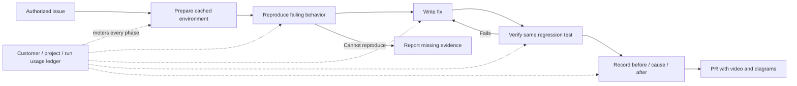

# Issue fixes with reproduction, video evidence, and cost accounting

Implementation direction: keep application policy and orchestration in Haskell, with minimal JavaScript at unavoidable upstream SDK boundaries. The existing worker is a research prototype. See [Haskell ownership and the RPC/MCP migration](2026-09-30-pr-impact-review.md#haskell-ownership-revised-implementation-direction) before extending it.

Required product behavior, recorded 2026-10-20. This is the implementation contract, not a claim of completion.
The existing impact-review prototype provides checkout exploration, scoped logs/spans/metrics queries, and service knowledge. The workflow below adds reproduction, fixes, verification, publication, and metering.

For current implementation status and the latest verification result, use the [2026-10-22 checkpoint](2026-09-30-pr-impact-review.md#current-implementation-checkpoint--2026-10-22). The migration notes below record intermediate stages; their test counts and pending-work statements are historical.

Current Haskell ownership includes agent supervision, admission, independent review, retained-candidate verification, explanation rendering, media reads and a separately tested native draft-publication effect. Git, Graphviz, FFmpeg and FFprobe must be provisioned on the application job host. The renderer retains the existing four-scene video/diagram/caption contract and validates cached media before reuse. Application fix-PR publication, full resource prices and deployment packaging remain unfinished.

A new local migration probe found that Pi RPC session totals omit a failed compaction's reported tokens. A separate SDK-level usage journal reconciled all synthetic provider calls. Keep the current metered SDK path while the native supervisor gains durable per-call receipts; RPC session totals cannot replace the billing ledger. See [the measured accounting boundary](2026-09-30-pr-impact-review.md#measured-rpc-accounting-gap-and-minimal-sdk-boundary).

Lifecycle accounting now stores a typed model-call start before provider work is allowed. Starts and usage reconcile by call ID under the same attempt and billing snapshot. Missing usage stays visible and unpriced at run/project/customer levels. Apply migrations `0246_agent_model_calls.sql` and `0247_agent_model_call_attempt.sql` before running the updated worker. The small SDK boundary and existing outbox carry these receipts; native Haskell Pi supervision remains pending.

### Persisted phase foundation (2026-10-20)

`Models.Projects.IssueFixes` now persists an append-only phase history, reconstructed through private reproduction and verification proof types. Migrations `0232` and `0233` add runs, versioned steps, and immutable execution identities. Starts and receipt retries are idempotent; concurrent writers cannot both advance one version.

A run pins its issue, project, service mapping, GitHub installation, base revision, guest image, and initial billing attribution. Appending a step rechecks the current repository grant. A usable base failure permits a candidate; verification then requires a fresh base failure and candidate pass with the same script hash, image, and configured resources. Setup errors do not reproduce a bug. A changed candidate clears verification, and a changed test requires reproduction again.

The test watcher passed all four impact-review examples, including persisted reload, duplicate/conflicting receipts, concurrent updates, project isolation, revoked mappings/installations, frozen test identity, and billing changes. Fourmolu and HLint passed. Review found and fixed a missing doctest setup import; the standalone doctest suite has not run for this slice.

This is a persistence foundation. No issue job, editing agent, semantic test review, test artifact admission, video renderer, or source-fix publisher invokes these transitions yet. `Verified` means the admitted execution pair passes these checks; it does not prove test relevance or authorize publication. General attempt accounting, compute/storage/video pricing, and customer charges remain pending.

## Evidence gates

| Phase | Required evidence before advancing |
| --- | --- |
| Prepare | Authorized project/repository/issue, pinned base, toolchain image, dependency locks, test profile, budget reservation. |
| Reproduce | A saved regression test that fails because of the reported bug, with command, exit status, and logs. Missing dependencies are setup failures. |
| Fix | Root cause tied to the reproduction; a minimal production patch on an isolated branch. |
| Verify | The unchanged regression test passes with the fix. It still fails on the base. Required related checks pass. |
| Explain | A short video uses actual before/after evidence, explains the cause, and shows the successful check. |
| Publish | Verified head still matches the branch; artifacts exist; required reviews/checks passed; usage has been persisted. |

The host controls phase transitions. A model's claim that a test passed is insufficient.
Store test hashes, source revisions, commands, exit statuses, log digests, and environment fingerprints as evidence.
During reproduction, accept only the test/fixture patch. Replay it against a clean base before authorizing production edits.
Freeze that test artifact for verification. Changing the test requires reproducing again; deleting or weakening it cannot satisfy verification.
For a pre-existing PR, apply the same regression test to base and proposed head to establish failing and passing behavior.
If reproduction remains unavailable, report the blocker and retained evidence. Never publish a successful fix claim or fabricated before footage.

Use persisted, resumable phase jobs with explicit budgets. The prototype's seven-minute agent deadline is not a full build/test/video workflow budget.
An interrupted video render resumes from verified artifacts. A changed candidate revision invalidates verification and the corresponding explanation.
Only the trusted publisher receives branch-write and PR-write credentials. Repository commands do not receive them.

## The PR deliverable

Keep the description brief: issue link, root cause, change, verified checks, video, and an optional diagram.
Target a 30–60 second explanation: reproduce the symptom, illustrate the cause, show the fix, replay the check.
Use captions and highlighted actions. Add self-hosted narration where useful. Avoid recording dependency installation or model deliberation.
For backend bugs, show the actual failing/passing test, request, trace, or metric; a browser demo is not mandatory.
Label illustrative diagrams as explanation. They do not replace recorded test evidence.
Render telemetry charts through the existing shared widget PNG design.

Reuse [Playwright recording](https://playwright.dev/docs/videos) for browser behavior and [VHS](https://github.com/charmbracelet/vhs) for terminal demonstrations.
Compose clips, captions, and diagrams locally with FFmpeg. [Remotion](https://github.com/remotion-dev/remotion) is an optional richer compositor with a company-license condition; account for rendering/license costs before adoption.

[GitHub CLI supports native video attachments](https://docs.github.com/en/github-cli/github-cli/attaching-files-with-github-cli): `gh pr edit --body-file description.md --attach explanation.mp4`.
The currently installed CLI, 2.96.0, does not expose `--attach`. The publisher image needs a pinned compatible version and a verified upload capability.
Use H.264 MP4 and a small diagram. Verify supported permissions and repository visibility before publishing private evidence.
Artifacts remain in our S3-compatible storage with project authorization and retention. PR uploads are a separate publication copy.
When native upload is unavailable, report that limitation; a thumbnail linking to our authenticated player is a fallback, not a claimed native attachment.

## Reuse builds and artifacts efficiently

| Layer | Reuse boundary |
| --- | --- |
| Toolchain and browser image | Immutable, versioned images shared where they contain no customer code or credentials. |
| Repository objects | Tenant/repository-scoped mirrors; fetch incrementally and pin exact commits. |
| Dependency cache | Key by platform/architecture, compiler/runtime, lockfiles, build flags, and image digest. |
| Build workspace | Stable guest path such as `/workspace`; trusted baseline plus a private writable overlay per run. |
| Test data | Snapshot isolated databases and fixtures; reset between failing/passing runs. |
| Explanation artifacts | Reuse captured evidence and diagrams for the verified revision; rerender only changed presentation. |

Keep the VM and long-lived build/test watchers alive across phases of one run.
Do not share writable build directories or watchers concurrently across runs or customers.
Promote reusable cache entries only through a trusted preparation job. Untrusted PR writes remain in their own overlay.
Public immutable dependencies may be shared; private source, compiled private modules, snapshots, and recordings require tenant isolation.
Record hit/miss, restored bytes, preparation time, build time, and estimated savings. A cache hit still incurs its actual resource cost.

Monoscope already shares `~/.cabal/store` and seeds dependency sources through `make worktree`.
Its Makefile records that copying local Haskell build outputs to another absolute path triggers recompilation.
Keep compiler version, architecture, flags, and absolute guest path stable. Do not reuse macOS build output in a Linux guest.
Gondolin 0.13.0 exposes disk-only checkpoints and fresh copy-on-write resumes. That does not preserve running GHCi processes.
The original prototype retained project-scoped Git objects but destroyed each workspace. Project build checkpoints are now implemented below; memory/watchers, full server/DB preparation, production Linux measurements, and automatic cache lifecycle remain unfinished.

## Curated upstream skills

Use upstream skills, pinned to reviewed source revisions. Load repository instructions first and preserve project-specific watcher/test rules.
Skills guide the agent; the host enforces evidence, authorization, accounting, and publication gates.
Do not install arbitrary new skills or run upstream installers during a customer job.

| Source / skills | Verified adoption on 2026-10-20 | Purpose |
| --- | --- | --- |
| [obra/superpowers](https://github.com/obra/superpowers): systematic-debugging, test-driven-development, verification-before-completion | About 301K, 255K, and 247K installs respectively; repository about 302K stars | Root-cause investigation and the failing-test/fix/verification sequence. |
| [microsoft/playwright-cli](https://github.com/microsoft/playwright-cli): playwright-cli | About 191K installs; repository about 14K stars | Browser exploration, screenshots, traces, and recordings. |
| [anthropics/skills](https://github.com/anthropics/skills): webapp-testing | About 183K installs; repository about 182K stars | Optional Python/Playwright testing and server orchestration. |
| [remotion-dev/skills](https://github.com/remotion-dev/skills): remotion-best-practices | About 650K installs; repository about 5K stars | Optional video composition; renderer licensing is a separate decision. |

Candidate revisions: Superpowers `bb92a77741419a4ab5f06e711a283343f1ada0c3`; Playwright CLI `b1a5903c5b633b8c9f843ad7b629c2a78437040c`; Anthropic skills `dbd4588f9e1033efb41dad4bef2f7947c8993d44`; Remotion skills `039e8a2fc78b67efc228d5645367838b85818a1c`.
Counts come from [skills.sh](https://skills.sh/); repository revisions and stars were checked through GitHub's repository API. The three Superpowers skills are now vendored at that revision; the browser and video candidates remain researched, not bundled.
Start with the three debugging/verification skills and one browser skill. Load video composition skills only for explanation work.

## Cost accounting is required from the first run

Every operation must have server-assigned customer/billing-account, project, run, attempt, and phase attribution.
The agent cannot choose billing identity. Resolve it from authorized project ownership and snapshot the assignment for historical reporting.
Existing `Project.customerId` is an optional external payment-provider identifier. Projects without one still need internal cost attribution.

Record immutable usage events with producer/request IDs and an idempotency key. Distinguish repeated delivery from a genuinely new retry attempt.
Capture model usage after every response, including unsuccessful attempts, rather than only after the final agent result.
Persist attempt-start events and a durable receipt/outbox; reconcile interrupted calls whose provider usage is not yet known.
An unavailable price or lost receipt means unknown/provisional cost, never zero.

| Cost category | Measurement |
| --- | --- |
| Model inference | Provider, model, request ID, service tier, input/output/cache usage, rate-card version, estimated or reconciled amount. |
| Sandbox and builds | Allocated CPU/RAM time, disk usage, preparation/build/test duration, resource-rate version. |
| Recording and rendering | Browser/encoder resources and any speech/model/licensing charges, without duplicating sandbox compute. |
| Artifacts and network | Retained byte-time, snapshots, recordings, transfer/egress, and deletion time. |
| Shared warm capacity | Explicit allocation policy or platform overhead; never charge the same preparation cost fully to every reuse. |

Keep raw provider usage and normalized units. Cached input and reasoning tokens must not be billed twice.
Use exact decimal rates or integer sub-dollar units. Round at the billing aggregation boundary, not independently for every token or call.
Store original costs and append corrections. Preserve currency, pricing version, measurement source, and reconciliation status.
On-premises compute cost uses an explicit allocation model; it is not automatically a provider invoice amount.
Track every failure, timeout, cancellation, and retry internally. Customer billability is a separate, versioned policy.

Show live estimated spend and final/reconciled spend on each run. Provide project and customer summaries with phase/resource breakdowns.
Show internal cost and margin to staff; show customer usage and customer charges within their authorized projects.
Show cache hit rate, retries, stopped runs, and budget remaining alongside cost. Budgets reserve capacity before parallel work starts.

Keep incurred cost, customer charge, and gross margin separate. A target gross margin `m` implies `charge = cost / (1 - m)`.
A markup uses `charge = cost * (1 + markup)`; these are different policies. Store the policy version used for each charge.
Do not enable automatic charges until the pricing/billability policy is explicitly configured.

Reuse Monoscope's `projects.ai_usage`, billing pages, and `usage_report_submissions` where their contracts fit.
Current AI usage is project/model/source based. It lacks run/attempt/phase IDs, cache categories, reconciliation, and non-model resource costs.
Its `cost_microusd` feeds existing billing totals. Do not mix provisional internal costs into customer-charge totals.
The CodeReview protocol now includes typed Usage frames with idempotent persistence. Completed receipt writes now survive worker process loss and replay on the same run retry. Recovery of calls interrupted before a receipt exists and non-model resource metering remain pending.
The benchmark JSON and production model receipts contain SDK estimates. They do not establish reconciled costs or the complete cross-resource accounting contract.

[Self-hosted LiteLLM](https://docs.litellm.ai/docs/simple_proxy) is a candidate for model gateway metering, pricing maps, and budgets.
Its [spend tracking](https://docs.litellm.ai/docs/proxy/cost_tracking) covers model requests; some tagging features depend on edition.
It does not replace the cross-resource ledger or trusted customer attribution. Existing payment submission code should be reused before adding a second billing system.

## Delivery and acceptance

1. Add durable, idempotent run-level usage receipts and cost views before enabling customer jobs. Verify failure, retry, duplicate delivery, missing price, and customer/project isolation.
2. Enforce reproduction and verification as persisted host-controlled phases. Prove that an unchanged regression test fails on base and passes on the fix.
3. Add pinned toolchain profiles and reusable workspace snapshots. Measure cold/warm runs; verify lockfile/compiler invalidation and isolated concurrent overlays.
4. Capture and compose a real before/cause/after video. Verify its content, encoding, captions, artifact permissions, and revision linkage.
5. Publish the fix PR with native attachments and concise description. Retry publication without duplicating PRs, attachments, or charges.
6. Compare several real issue fixes, including unreproducible cases. Report completion rate, incorrect fixes, review effort, latency, and full resource cost.

### First implementation slice (2026-10-20)

Production reviews now emit usage receipts for provider responses, including failed calls, and retain accepted receipts if the review process subsequently fails.
The server assigns project and current billing-customer attribution from the run; wire messages cannot choose a project or customer.
Duplicate receipt delivery does not increase cost. Conflicting content for an existing receipt ID aborts the review.
Migration `0229_pr_review_usage.sql` stores model estimates separately from `projects.ai_usage`; automatic customer charges remain unchanged.
Review history shows per-run and all-time project model estimates, failed calls, and unpriced calls. Unknown amounts are excluded explicitly.
Tests first failed because the CLI emitted zero receipts. The updated microVM/transport test verifies receipts, cached-token accounting, and error receipts without final drafts.
Haskell integration checks verify persistence, duplicate/conflict handling, project/customer attribution, project isolation, rendered costs, retention after process failure, and no billable-AI records.
Still pending: full billing-account authorization, full resource costs, durable outbox/reconciliation, budgets, reproduction/fix phases, prepared build caches, and video publication. Scoped customer/project subtotals are described below.

The final local review ran haskell-constraint-review, hs-lob-review, and hs-distill across two passes over the complete change.
Applied findings include distinct typed receipt/attempt IDs, explicit unknown-cost display, and a linked-customer attribution regression rather than a null-only fixture.
The focused watcher passed all three impact-review integration examples after the last edit. The actual CLI/microVM test passed, including cached-token pricing and failed-response receipt flushing.
Fourmolu 0.19, HLint, and whitespace checks passed. These checks do not establish customer-wide reporting, complete resource metering, or hard-crash recovery.

### Scoped customer/project reporting (2026-10-20)

The Repositories Usage tab now groups model estimates by the billing customer recorded with each call, with project breakdowns.
Its query admits only non-deleted projects where the signed-in user has an active administrator membership. A shared customer ID grants no access by itself.
The view labels these as scoped subtotals; complete payment-account reporting still requires an explicit billing-account authorization model.
Null and empty customer references remain separate project buckets. An unlinked project's provider change does not duplicate its project row or split its total.
Cost components use one typed summary and PostgreSQL composite decoding. Aggregation adds counts and exact nanodollar amounts before display.
The test first failed because the Usage route was unavailable. Further regressions reproduced blank-customer grouping and provider-change duplication before their fixes.
Integration fixtures include an administered project, a viewer-only project, an inactive membership, and two unlinked projects sharing provider metadata.
The completed test checks customer subtotals, project links, hidden-project exclusion, and unchanged billable-AI usage.
The existing issue-fix entry point remains unimplemented; the source issue type is an outstanding clarification, independent of this reporting work.

### Pinned debugging and verification skills (2026-10-20)

Every checkout review now includes the three Superpowers debugging/TDD/verification skills.
The worker vendors the unmodified instructions, referenced debugging/test helpers, MIT license, source revision, and file hashes. Jobs perform no skill installation or download.
Pi advertises descriptions and guest paths, then loads full instructions through the guest read tool when relevant. Repository instructions, including watcher/test rules, take precedence over generic upstream examples and advice.
The regression first failed with `bundled skill missing: systematic-debugging`. The updated real-microVM test verifies discovery, reads the upstream debugging instructions and a companion reference through guest tools, and exercises the actual CLI/provider transport.
This establishes pack availability, not model compliance, improved review quality, or host-enforced reproduction. Browser/video tools and build-cache reuse remain pending.

### Durable model receipt replay (2026-10-20)

The host now supplies a typed review-run ID in each CLI request. A required, private `IMPACT_REVIEW_USAGE_DIR` holds per-run receipt files on persistent server storage.
The CLI uses pinned `write-file-atomic` 7.0.0 for file fsync and atomic rename, then fsyncs directory changes. It persists before sending and deletes only after the server acknowledges persistence.
Retries replay the original receipt IDs and contents before any new model call. Other run directories are not read; rejected receipts remain pending.
The test first failed because a receipt was transmitted without an outbox file. The updated real CLI test verifies write-before-send, retirement after acknowledgement, a killed replay process, rejection, subsequent acknowledgement, and run isolation without starting new model work.
The server's existing idempotency checks prevent replay from increasing recorded cost. The focused Haskell watcher passed all three impact-review integration examples with the typed run ID.
At that stage, billing references were resolved at first server receipt persistence. The attempt-start update below now pins new attempts before worker launch. Interrupted-provider-call reconciliation and background draining for runs that never retry remain pending.
This is durable receipt replay on retry, not complete hard-crash accounting. Automatic customer charging remains unchanged.

### Project-scoped repository object cache (2026-10-20)

Production requests now carry a typed server-assigned project ID. The CLI requires a private persistent `IMPACT_REVIEW_CACHE_DIR`; direct library/evaluation callers may omit caching.
Mirrors are keyed by project ID and repository URL hash. Every run checks source access with `git ls-remote`, then fetches its exact base/head with current credentials, even on a hit. Source failure aborts before model execution; cached objects are not an offline authorization fallback.
Pinned `proper-lockfile` 4.1.2 serializes mirror fetch/clone and cancels preparation if the lock is compromised. Each run copies objects without hard links into its own checkout, then into the guest workspace. Cache paths are never mounted into the guest.
The test first failed because preparation emitted no cache result. The real Git/microVM regression verifies cold/warm runs, pinned revisions, separate projects/repositories, concurrent preparation of a new head, and failure after a cached source becomes unavailable.
The source-unavailable regression exposed that `git fetch` can skip transport for cached commits. An explicit `ls-remote` check now prevents that authorization shortcut.
After the access-check fix, the local fixture measured about 400 ms cold and 293 ms warm. This is functional evidence and a small local-source timing, not a production network/build speedup claim.
Evaluation artifacts now retain checkout cache status and duration. Production persistence of those metrics, cache byte-time/retention/quotas, build/dependency caches, and VM reuse remain pending.

### Shared aggregate-table PNG correction (2026-10-20)

A render check exposed that a table snapshot such as `events=2, percent=100` was plotted with the count as a timestamp, creating a 1970 axis. Scalar tables lost their only numeric column entirely.
The shared PNG request now selects table mode for successfully loaded table widgets. `chart-png-options.ts` owns the layout for every caller, including impact reviews; the bot has no separate image renderer.
Headers and cells remain literal text, including zero and unknown values. Empty results and clipped rows/columns are labelled. The existing Slack dimensions and light/dark palette remain shared.
The SVG regression first failed on missing table headers. Temporarily restoring chart mode at the real PNG handler made two different scalar values produce identical images, failing the integration guard; restoring table mode passed it.
The focused watcher passed all three impact-review examples. The shared PNG suite passed 24 cases, TypeScript typechecking passed, and the rebuilt chart CLI produced manually inspected light/dark PNGs.
This verifies rendering behavior, not publication of an issue-fix video or a deployed server image.

### Validated review submission (2026-10-20)

The review harness now uses structured submission with host feedback. Schema failures and host citation/evidence errors return to the model; it can repair a draft before finishing.
The production interpreter rejects final payloads without a matching accepted submission. Queries and further agent tool use require fresh validation. Final publication checks remain independent.
Tests exercise schema repair, citation repair, stale acceptance, skipped validation, changed final payloads, and continued usage accounting. The live OpenAI CLI smoke check completed with one accepted finding and retained every model receipt.
These are review-output gates. They do not replace the persisted failing-test/fix/verification phase gates required above.

### Frozen regression replay (2026-10-20)

The common review backend now offers `run_regression`: one frozen script runs on pinned base/head revisions in fresh VMs using one imported image build. Shell tools run as UID 1000; supervisor binaries, scripts, and log paths remain protected.
Private artifacts retain scripts, bounded logs, source hashes, revisions, image identity, and project/run/attempt attribution. File and directory writes are fsynced. VM duration and configured resources are recorded as unpriced; ledger ingestion and UI pricing remain pending.
The real microVM regression exercises repository behavior that preserves a retry token on base and drops it on head. Checks detect source changes hidden with assume-unchanged, block missing commands, and enforce a comparison budget. An output-limit test exposed an unhandled command rejection during shutdown; the command promise now has a rejection observer while normal completion still awaits its result.
Each revision has a 120-second deadline and 1 MiB output limit. Full logs are accessible through protected guest paths. Cancellation includes the individual tool signal. Cleanup failure prevents further comparisons in that session.
The default guest has no Haskell compiler or browser. Prepared build profiles, semantic test review, persisted issue-fix phases, automatic fixes, videos, publication, and full resource accounting remain pending. Replay results alone grant none of those transitions.
Verification: the real Pi/provider/Gondolin/libkrun integration passed after the output-limit fix (23.0 seconds). The focused watcher passed three impact-review examples; the restored server watcher compiled and started. The PNG/stat suites passed 39 tests; TypeScript, Fourmolu, HLint, vendored skill hashes, and dependency-pin checks passed. Linux/KVM, full CI, deployment, and native PR video upload were not verified.

### Server-visible execution receipts (2026-10-20)

Verifier executions now emit typed `Check` protocol receipts. The worker persists them before transmission, replays them before new model work, and retires them only after acknowledgement. Existing model receipt files remain compatible.
Migration `0230_pr_review_checks.sql` stores immutable execution metadata separately from model estimates and customer charges. The server assigns project and current billing attribution, checks revision linkage, accepts identical retries, and rejects conflicting receipt contents.
Review history groups base/head results by comparison and shows status, revision, elapsed time, and configured CPU/RAM. Compute cost remains explicitly unpriced. Scripts and logs stay private; only their identities and bounded metadata cross the protocol.
This closes the gap between private worker replay artifacts and review history. It does not implement persisted issue-fix phase transitions, prove semantic test relevance, price resource usage, or enable automatic fixes/publication.
The protocol regression first failed on an unrecognized `Check` message. The updated watcher passed all three impact-review examples, including duplicate/conflict handling, revision rejection, project isolation, grouped base/head display, retained receipts after agent failure, and invalidation of an earlier accepted draft.
The real CLI/provider/microVM integration passed in 29.6 seconds, including write-before-send, interruption, rejection, acknowledgement, and replay of execution receipts before new model work. The server watcher compiled and started; Fourmolu and HLint passed. No live provider inference, Linux/KVM deployment, full CI, or video publication was exercised in this slice.

### Logs, spans, metrics, and reusable knowledge (2026-10-20)

The user's clarification requires signal-specific investigation and maintained knowledge. The aggregate-only restriction has been removed. The reviewer reuses Monoscope's read-only KQL engine and shared KQL guide, including metric counter/gauge semantics.
Queries support private log/span samples, projections, grouping, and metric aggregates. The host retains project/service/time scope, checks authorization before and after reads, and bounds query time, rows, fields, and response size. Numeric aggregates retain the shared PNG path; event rows never become public snapshots or comment text.
`recall_knowledge` and `remember_knowledge` reuse the review protocol. Notes require current evidence for the mapped service. They are staged during investigation and promoted atomically with successful completion into `projects.pr_review_knowledge`, with source review/revision, observation window, and evidence references. Snapshots omit query row datasets. Failed or unpublished attempts add no knowledge; retries do not erase completed notes.
Recall is scoped by project, repository, and service and returns at most twenty dated notes. It does not claim semantic ranking, verified facts, automatic consolidation, or contradiction resolution. The agent must recheck old conclusions. Notes appear under a private review-history disclosure and stay out of public comments.
The memory design was compared with [Letta's agent-editable/read-only memory blocks](https://docs.letta.com/v1-sdk/memory/memory-blocks) and [Mem0's self-hosted metadata filtering](https://docs.mem0.ai/open-source/features/metadata-filtering). Those are useful patterns for later consolidation and semantic retrieval. This slice uses existing PostgreSQL and the review lifecycle, with no new memory service or embedding calls.
The expanded fixture reads a log sample, a real ingested span, and a gauge through the production query adapter, then remembers and recalls a note across retries. A separate metrics-only path checks that missing log/span counts do not prevent investigation. A regression also reproduced the check-history limit incorrectly selecting other projects' runs; the subquery now scopes runs through their project-owned threads.
Verification reproduced both the skipped metrics-only investigation and its misleading “no telemetry” coverage before their fixes. A long-log regression exposed silent field clipping; query results and coverage now report truncation explicitly. The focused watcher passed all three impact-review examples after the final fix. The real CLI/provider/microVM integration passed with knowledge tool calls and complete model receipts; these checks used a deterministic local provider, not a live-model quality evaluation.
Server compilation passed. The watcher's runtime restart encountered an existing process bound to port 8080; handler behavior was verified through integration tests. Linux/KVM, full CI, deployment, semantic memory ranking/consolidation, and issue-fix video publication remain unverified or unimplemented.

### Live review quality check (2026-10-20)

Live OpenAI runs exercised metric/log/span queries and knowledge recall/staging through the actual CLI and local microVM, using synthetic snapshots. The original bug was identified. The fixed control exposed a false positive about a pre-existing uncancelled action; stronger base/head instructions and schema guidance produced zero findings in the rerun. This is one sample per condition, not a general precision result.
Both sides' frozen checks were blocked by missing `make`; no bug reproduction or fix verification was claimed. Prepared project toolchains remain necessary before issue-fix phase gates can succeed. Detailed timings, estimates, and private artifact paths are in the impact-review plan.
Model totals also need summarization/compaction accounting in addition to interrupted-call reconciliation. Current assistant-response estimates are not complete customer costs or billable amounts.

### Compaction usage receipt correction (2026-10-20)

Model receipt capture now wraps Pi's transport boundary, covering compaction in addition to conversation responses. A real SDK compaction regression first exposed six provider responses but only five receipts, then passed with all six recorded once and the summary's token/cost values preserved. Existing durable replay and failure checks remain green. Cache refresh and branch summaries share the inspected transport; they were not separately forced in this test. Provider reconciliation and non-model costs still require implementation before customer billing.

### Investigation snapshot reuse (2026-10-20)

Exact telemetry requests now reuse their first evidence snapshot within one review. Authorization is checked before serving cached evidence; separate reviews and failed queries do not share results. The distinct-query budget counts saved snapshots, while the overall RPC budget still counts every request. The regression verifies stable keys/data after a metric changes and rejects cached reads after permission revocation. Broader compiler/dependency/artifact cache reuse remains pending.

### Prepared Monoscope compiler image (2026-10-20)

An optional image profile now reuses the local dependency image's compiler and package store and installs the CLI built from current sources. Build inputs are isolated from local credentials/artifacts, the base is resolved to an immutable ID, and the final Gondolin manifest records the prepared image identity. The runtime uses the same image for review and verifier VMs with isolated COW writes.
The production `run_regression` path now has a real prepared-profile test: a frozen Makefile invokes the CLI and cached Aeson, passes on base, and fails on an intentionally broken head. Cache writes do not cross VM boundaries. This exposed and fixed missing UTF-8 locale and a scratch mount hiding Cabal's store.
The local rootfs is about 16.4 GiB; preparation took minutes, while the two verifier executions each took about one second. These fixture timings do not establish production cost savings. Full repository server/DB watchers, frontend cache restoration, reusable object snapshots, dependency/profile lifecycle, and video phases remain pending. Production access remains through the reviewer’s authorized host tools. The installed CLI has no production key or network egress, and direct API access is not configured.

### Existing issue and publication entry points (2026-10-20)

`Pages.Issues.issueDetailGetH` renders a “Plan a fix” action that only prefills the issue chat. There is no automatic issue-to-PR job behind it. `BgJobs.ReviewPullRequest` dispatches to `Pkg.ImpactReview.reviewPullRequest` for advisory review; its completed state is not evidence that an issue fix was verified.
`Pkg.Git.publishConfiguration` already performs host-side GitHub tree/commit/ref/PR operations with target-revision and ownership checks. Its titles, bodies, and ownership markers are specific to configuration sync. The issue-fix publisher should reuse or extract those Git operations after the reproduction/verification gates exist, rather than overload configuration metadata or place write credentials in repository tools.
The comparison driver now validates citations/evidence in both modes and records compaction costs through the shared receipt normalizer. That makes research artifacts more faithful; it does not implement the issue-fix lifecycle described above.

### Attempt billing snapshots and missing receipts (2026-10-20)

The billing-change regression first failed with zero of four model/check receipts attributed to the customer present before worker launch. The server now creates `projects.pr_review_attempts` before launching the agent, captures project/run, configured provider/model, and billing identity, and supplies the attempt ID to the CLI. New model/check receipts use that immutable snapshot. A customer that was unlinked at attempt start remains unlinked even if a customer is added before receipt persistence. Known attempts cannot be reused across runs/projects or model providers.

Migrations `0234` and `0235` add attempt snapshots, composite receipt foreign keys, and receipt lookup indexes. Older receipts remain recoverable with explicit attribution-on-receipt counts; their historical billing assignment is not rewritten. New attempts that produce no model receipts appear in project/run and administrator customer totals with unknown cost. A late receipt removes that missing-receipt count without charging or inventing an amount. Some receipts do not prove every call in an interrupted attempt was recovered.

A second regression reproduced the missing-receipt display gap before its fix. The watcher now passes all four impact-review examples, including billing-provider changes, delayed/idempotent replay, an initially unlinked customer, cross-project/provider rejection, unknown-cost display in both views, and late receipt recovery. The real worker/Pi/microVM suite passes both tests with no skips, including the prepared compiler profile; the CLI retains the server-assigned attempt ID. Fourmolu, HLint, and whitespace checks pass. The server compiles; its runtime still encounters the existing port-8080 conflict. Tests use a local deterministic provider; no paid inference, deployment, full CI, or new video publication was exercised.

This closes pre-launch billing attribution for the advisory worker. Per-call start/reconciliation, draining abandoned outboxes, resource prices, complete internal billing-account ownership, margin calculation, automatic charges, and wiring the issue-fix workflow remain pending.

### Retained regression artifacts (2026-10-20)

`run_regression` now accepts and privately retains a frozen Git test patch. Git applies it through the index on each clean revision or checks that it already exists. Full fingerprints of the patched files must match across revisions, including file mode and symlink targets. Added test files enter the protected source manifest, so editing them during execution invalidates the check. Patches are bounded to 262,144 characters and 100 paths; invalid patches block verification.

The receipt's typed `Regression` evidence distinguishes a command-only check, an injected test, and a test retained in the candidate. Its digest binds the script, patch, and expected assertion. The phase gate rejects reproduction without test artifact evidence and refuses a passing candidate that only received an injected test. Changed artifact identity requires reproducing again. Older advisory receipt payloads remain readable and idempotent; execution-only observations cannot establish new issue-fix reproduction proof.

The real microVM test first exposed a blocked base because the new test was absent. It now exercises base failure, candidate success with the test retained, success with an injected-only test, changed candidate tests, mutations during execution, and malformed patches. The watcher separately reproduced acceptance of a changed artifact and an injected-only candidate before the gate fixes. All four integration examples now pass, including legacy receipt/history replay. The full worker suite passed three tests with no skips, including the prepared compiler profile; the final expanded artifact test also passed. Fourmolu, HLint, and whitespace checks pass.

This establishes artifact continuity and retention, not semantic reproduction of an arbitrary reported issue. Test-only patch admission, root-cause review, the editing agent, issue jobs, videos, and publication remain pending. No paid inference or external publication was exercised.

### Source-fix library (2026-10-21)

`fix.mjs` now shares the repository-agent runtime with advisory review. It requires an issue ID, a caller-assigned persisted attempt ID, private artifacts, metering events, a host test-admission policy, and acknowledged phase persistence. It exposes separate reproduction, candidate, verification, and submission tools. Repository content stays read-only to the agent until an admitted regression fails on base and its observation is acknowledged.

The workflow retains the regression in the editing workspace, captures a native patch, creates a private candidate commit, and replays the frozen test on base/candidate in fresh VMs. A changed captured patch invalidates submission. Artifacts include the patch, attributed metadata, and a hashed/fsynced Git bundle containing the exact candidate commit. A test recovers that commit from the bundle after the temporary checkout has been deleted. Neither repository commands nor the agent receive publication credentials.

The new fixture first failed because the workflow was absent. Its first full run exposed a fixture using the machine's display diff helper; native Git patch generation now matches production capture. The passing flow rejects early writes and candidates, rejects a non-test patch, reproduces the actual broken runtime, edits it, verifies the unchanged retained test, rejects a later test change, and re-verifies the repaired candidate. Further cases reject phase-persistence failure and cancellation during admission. All four worker/microVM tests pass, including advisory/CLI regressions and the prepared compiler profile. The Haskell watcher also passes all four impact-review examples. These tests use a deterministic local model and a fixture-specific admission policy; no paid inference or external publication occurred.

At this stage the library had no CLI path. The protocol update below now connects it to the process boundary. Production issue jobs, the real admission policy, authorized usage callbacks, budgets and resume orchestration still need wiring before customer runs. Resource pricing, source-fix review gates, videos, and PR publication remain pending.

### Typed fix protocol and durable phase delivery (2026-10-21)

The Haskell effect now exposes `FixRepository` separately from advisory review, with typed admission, phase, and result callbacks. Requests distinguish review and issue-fix run IDs at compile time. A shared types module owns the existing refined revision and phase types, avoiding a cycle through the server effect stack. The process runner preserves exact accepted-payload matching and decodes fix results into their own type.

The CLI accepts `FixTask` envelopes and invokes the fix engine with host admission, phase persistence, and final validation. Phase deliveries have stable IDs and reach the durable outbox before transmission. Recovery sends usage/check receipts before dependent phases, keeps rejected deliveries, and completes before new model work. Existing flat advisory requests and their outbox paths remain compatible.

Both new boundaries first failed while unwired. The fresh test watcher now passes five integration examples, including a real child protocol driving the actual phase store through admission, reproduction, candidate proposal, counterfactual verification, duplicate delivery, rejected persistence, invalid revisions, tampered final results, and post-validation phase calls. The worker suite passes all four tests with no skips; its real CLI/Pi/microVM test also verifies host validation, phase write-before-send, rejection/retirement, and receipt-before-phase replay without additional model calls. Fourmolu, HLint, and whitespace checks pass. The server watcher compiles; its runtime still encounters the existing port-8080 conflict.

The test watcher was restarted once after direct evidence that it retained an older object file lacking the new example. The replacement stays running; later changes use its normal reload loop. Tests use deterministic local providers and fixture admission policies. No paid inference, full CI, deployment, customer issue job, video, or PR publication was exercised. Production policy, generic fix-usage persistence, job/permission/budget/resume orchestration, and the publication stages remain pending.

### Shared review and fix accounting (2026-10-21)

`Models.Projects.AgentUsage` now owns attempt snapshots, model/check receipts, and usage totals for typed review and issue-fix targets. Migration `0236` preserves legacy review columns and adds explicit fix-run references, exclusive target constraints, and composite attempt foreign keys. Fix receipts require a known attempt for the same project and run; model receipts also require its provider. Identical retries succeed, conflicting receipts fail, and delayed receipts retain the original customer/provider snapshot, including an initially unlinked customer.

The review history keeps per-review totals and now shows the combined project total. The administrator usage view includes both workflows under the captured customer and project. Missing model receipts count as attempts with unknown cost; late receipts replace that count. Failed runs and rejected final submissions retain reported usage. Model estimates remain separate from customer charges.

The test first failed because a fix attempt could not be persisted. All five watcher integration examples now pass. The child-protocol example uses the actual ledger and phase store, covering mixed totals, receipt retries/conflicts, unknown attempts, cross-project/workflow/provider rejection, billing changes, initially unlinked customers, late unpriced usage, failed runs, and the rendered administrator usage view. Existing advisory accounting and authorization cases still pass. No paid inference, customer issue job, full CI, deployment, video, or external publication ran.

Production admission and job/permission/budget/resume orchestration still need wiring. Complete call reconciliation, compute/storage/video prices, margin calculation, and automatic charges remain pending.

### Separately metered regression admission (2026-10-21)

A distinct `AdmitTask` now reviews a proposed regression in a protected base checkout through Pi. The native patch must apply and contain 1–100 paths before model work. The reviewer can inspect the patched tests, actual runtime, and callers. Its policy rejects non-test changes, fabricated failures, weakened assertions, unsafe commands, and unrelated tests; insufficient evidence requires rejection. Both verdicts require a bounded rationale.

The Haskell `AdmitRegression` operation binds the returned decision to the exact submitted artifact. It denies telemetry, knowledge, nested admission, execution receipts, and phase mutations. Accepted payloads must survive the same final equality/exit checks as other tasks. A separate admission outbox prevents recovery from consuming fix phases; usage uses the existing fix ledger and a separately persisted attempt.

The real CLI test first failed while the task was unavailable. The full worker suite passes five tests with no skips, including protected admission, the editing workflow, replay, and the prepared compiler profile. The server watcher passes six integration examples, including typed admission, exact artifact binding, malformed/tampered results, unavailable capabilities, and cost persistence even after failure. Deterministic tests establish the protocol and execution mechanism.

The admission operation still needs to be invoked by the application issue job. Production authorization/lease/budget/resume orchestration, final artifact validation, broader live-model evaluation, videos, and publication remain pending. No full CI, deployment, customer job, or external publication ran.

Three small synthetic admission fixtures then ran against OpenAI `gpt-5.6-luna` with high reasoning: the real runtime regression was admitted; an unconditional fabricated failure and a production-source edit were rejected. Fourteen normalized model responses reported $0.01526608 in SDK estimates, recorded as internal research rather than customer charges. These toy cases do not establish accuracy on real customer issues.

The first production-edit trial failed before inference. Native Git index metadata copied into the guest was stale after ownership/permission changes, so `git apply --index` rejected existing files despite unchanged content. Refreshing the index after protecting the workspace fixed it. The regression test now covers patches touching production files for rejection and extending existing tests for admission. The failed trial remains in the research record; only that case reran live after the fix. The complete five-test worker suite passed again, with no skips.

### Application issue-job dispatcher (2026-10-21)

`FixIssue` now connects the application queue to the fix and admission operations. An active administrator can queue a prepared run once. An opaque ten-minute lease prevents duplicate workers; the prototype keeps its nine-minute agent deadline. The pinned repository/service/installation and current account/membership are rechecked through the job’s lifetime. Phase writes and completion lock job/run rows and bind the lease/version. Queued jobs cannot use the unleased phase-write API.

The dispatcher persists attempts before inference, scopes telemetry to the mapped service/window, calls the separate admission reviewer, and requires recorded execution receipts before accepting observations. Final metadata must match the persisted verified comparison, candidate cause, attempt, and frozen regression. Completion stores the result and promotes dated service knowledge atomically. Review and fix knowledge have distinct typed origins; promoted evidence drops raw datasets. Failed or tampered results retain usage without promoting knowledge. A fresh retry acknowledges reproduction reset after receipt recovery and reproduces again; it does not resume a VM.

`FixRequest` now carries the pinned image ID. The worker rejects a different prepared image before checkout/inference. The regression fails without that guard and passes with it. Another test reproduced an inactive account retaining job access through membership; append-only migration `0238` adds account status to the authorization view introduced in `0237`. Earlier migrations were preserved.

The watcher passes seven integration examples. The dispatcher example covers queue deduplication, account/role revocation, lease replacement, stale writes/cleanup, unrecorded or altered execution receipts, admission attribution, final comparison/cause binding, failed-result cost retention, retry, and knowledge provenance. It uses the real queue/dispatcher/database/process protocol with deterministic child fixtures. The separate worker suite passes all five tests with no skips, including the prepared compiler profile and fresh-attempt delivery. Fourmolu, HLint, and whitespace checks pass. The server compiles; its runtime still encounters the existing port-8080 conflict.

No paid inference, customer job, full CI, deployment, video, or publication ran in this slice. Customer launch UI, monetary budget reservations, final bundle validation, persistent build/VM resume, complete resource prices, video, and the PR publisher remain pending.

The SQL uses PostgreSQL’s [row-locking behavior](https://www.postgresql.org/docs/current/sql-select.html#SQL-FOR-UPDATE-SHARE) and [data-modifying CTE semantics](https://www.postgresql.org/docs/current/queries-with.html#QUERIES-WITH-MODIFYING): result/knowledge writes exchange rows through `RETURNING`, and leased phase/completion paths lock the affected job/run rows.

### Independent retained-artifact gate (2026-10-21)

The dispatcher now derives `ArtifactRequest` from the private verified phase state, including the exact recorded base/head receipts. A separate local `ArtifactsTask` process verifies candidate metadata, bounded regular files, patch/bundle digests, the frozen regression command/test/assertion, report identities/resources, unchanged source/test fingerprints, and log hashes/sizes. It leaves pending receipts untouched and needs no guest image, model configuration, network, or credentials.

Recovery uses a private clone of the existing tenant/repository mirror under its checkout lock. The archive must name only the expected candidate ref and exact base prerequisite. Native Git verifies/unbundles the pack, confirms the single base parent, and proves that applying the retained patch to base yields the candidate tree. This uses Git’s [documented archive format](https://git-scm.com/docs/gitformat-bundle) and [bundle operations](https://git-scm.com/docs/git-bundle); it does not compare version-dependent diff formatting.

The canonical interpreter returns an opaque `VerifiedFix` only for the exact requested result after host validation and successful child exit. Completion requires that proof and rechecks the lease, authorization, and phase history before atomically promoting knowledge. A future publisher must recheck the artifacts at publication time. Semantic test relevance remains an admission judgment rather than an artifact-integrity guarantee.

The failing test first exposed the missing CLI role. Its passing checks recover the exact candidate offline and reject altered metadata, patches, scripts, tests, logs, reports, symlinks, missing evidence, mismatched runs/attempts, a corrupt pack with an updated hash, a different valid patch, and an archive without the pinned base. The real CLI/Pi/microVM fix fixture also passes its generated artifacts through the new role. Application protocol fixtures exercise changed proof payloads and rejected completion/knowledge promotion.

This slice runs deterministic local providers. No paid inference, customer job, full CI, deployment, video, or external publication is claimed. Customer launch controls, monetary budget reservations, warm build/VM resume, compute/storage/video pricing, margin billing, video generation, and the PR publisher remain pending.

### Evidence-backed local video compositor (2026-10-21)

`explain.mjs` and the CLI `ExplainTask` now compose retained verification evidence into a 36-second, 1280×720 H.264 MP4, cause/change SVG diagram, WebVTT captions, and scene PNGs. FFmpeg and Graphviz run locally with sanitized subprocess environments; no hosted renderer or additional model call is used. Graphviz’s [quoted DOT labels](https://graphviz.org/doc/info/lang.html) keep model text out of markup and commands. [FFmpeg](https://ffmpeg.org/documentation.html) supplies the image composition and codec checks. VHS/Playwright remain available prior art for later interactive footage; this slice composes actual retained output rather than simulating a new terminal recording.

The renderer re-verifies the candidate and comparison first. Presentation text is bounded and bound to the accepted cause/change and actual log excerpts. The before scene includes the matching assertion; the cause remains labeled as inference. The private output manifest links project/run/candidate/revision/comparison/regression and media digests. Renderer source plus input identity controls cache reuse. Media digest checks reject corrupt caches; rendering uses a lock, private temporary directory, cleanup, and atomic fsynced publication within the private artifact tree. Render time is recorded as unpriced resource usage, not a customer charge.

The test first failed on the missing renderer. Tests exercise actual encoding/duration, selected evidence, invented/blank text rejection, captions, CLI validation/rejection, reuse, and regeneration. The real local-provider/Pi/microVM fix fixture renders its genuine failing-base/passing-candidate comparison. A storyboard was extracted from the MP4 and visually inspected. This fixture is a small shell-runtime bug, not a claim of a customer issue or complete Monoscope build. The local sample stays under ignored `scripts/local/`.

The Haskell job still completes at artifact verification. Automatic presentation selection, an explicit persisted explanation gate, authenticated playback/retention, complete resource pricing, and PR attachments remain unfinished. No customer job, paid inference, external publication, or deployment ran in this slice.

Review also reproduced a caption-decoding failure: a blank paragraph inside a recorded excerpt terminated the cue, dropping subsequent text. The compositor now normalizes paragraph spacing within cues and escapes WebVTT markup. The regression decodes the captions with FFmpeg and checks the selected paragraph survives. Render wall time and media/video byte counts remain explicit unpriced measurements; the small runtime fixture rendered in about 1.3 seconds and produced a roughly 126 KB MP4. These are fixture measurements, not a production cost forecast.

### Application explanation gate and resume (2026-10-21)

The issue job now invokes `ExplainFixTask` after independent artifact verification. It uses the accepted concise cause/change, the exact reproduced assertion, and recorded candidate exit status. This needs no extra model or manual presentation selection. Current producer bounds are 240 characters for cause and 180 for summary; historical phase replay keeps its original bound. The automatic candidate scene labels exit metadata explicitly rather than presenting generated text as captured stdout.

`CodeReview` returns an opaque `ExplainedFix` only for a successfully exited child with an identical validated manifest. The typed manifest binds project/run/issue/candidate/revision/comparison/regression and checks all seven media hashes, source/renderer digests, encoding dimensions/duration, size bounds, tool metadata, and explicit unpriced resource status. Completion now requires this media proof, the exact persisted checkpoint, current lease/authorization, and the same verified phase. Result, explanation, and service knowledge are committed together. Failed media work does not promote knowledge.

The dispatcher saves a verified candidate and its investigation before rendering. A retry reads that leased checkpoint, re-verifies local artifacts, and resumes rendering without another fixer/admission model call or GitHub token fetch. A checkpoint exposes read-only contents through a function; its constructor and record-update/JSON construction paths stay unavailable. Account/grant revocation and stale leases block access. A missing/corrupt retained candidate fails verification rather than silently becoming a new fix.

Migrations `0239` and `0240` add media and checkpoint identity. The initial checkpoint write correctly failed the existing completed result/investigation pairing constraint. Append-only migration `0241` therefore adds separate pending context and preserves that completed-state invariant; no applied migration was changed. The new checkpoint identity/context must be present together.

The first dispatcher regression failed because completion had no explanation. The retry regression then showed 12 model receipts where resumed work should retain 9; checkpoint reuse removes the repeated three model calls. Tests also cover malformed/changed manifests, missing media, invalid duration/pricing, no completion or knowledge on failure, revoked checkpoint access, stale owners, and unchanged completed-job idempotence. The application uses deterministic child fixtures, while the separate actual CLI/Pi/microVM test renders an automatically selected explanation from its real failing/passing regression evidence. No customer job, paid inference, external publication, deployment, or full CI is claimed.

Authenticated playback/retention, native PR attachments and publication gates, monetary budgets, warm build/VM reuse, complete resource-cost reconciliation, and margin billing remain unfinished. Render measurements remain unpriced; these estimates are not customer charges.

### Private media retention and authenticated player (2026-10-21)

The issue job now uploads all seven explanation assets to a configured private S3-compatible bucket on our servers. `AgentArtifacts` supplies paired production/test interpreters, typed failures, opaque verified bytes, and an opaque `RetainedFix`. Completion requires that proof and atomically records `media_retained_at` with the result, explanation, and knowledge. Applied migration `0242` adds the retention marker. Missing bucket/endpoint configuration fails before model work. Upload failure preserves the verified checkpoint; retry needs no new model call.

The local binary `MediaTask` verifies the exact private manifest and digest without loading the model/VM runtime. Native SDK uploads and reads bind project/run/candidate/source/content hashes and enforce 32 MiB per object. HTTP reads work without the worker or its local artifacts. Deployment configuration chooses the bucket/endpoint; migrations between stores must copy retained keys. Partial uploads can leave private orphans; lifecycle cleanup and quotas remain pending.

A new Issue fixes tab links to the authenticated player, with native controls, captions, poster, diagram, and recorded usage. Current active administrators need the pinned issue/service/repository grant. Demo guests are denied. Authorization runs before and after storage retrieval; responses are private and noncacheable. GET/HEAD, single ranges, MIME types, `nosniff`, and a sandbox policy are covered. Each range currently fetches and hashes the whole bounded object.

The watcher passes seven examples, including actual MinIO retention, unsigned denial, HTTP playback endpoints, range/HEAD behavior, cross-project and role isolation, in-flight revocation, corrupted object rejection, and storage retry. The configuration test first failed by launching model work without a bucket, then passed with zero new model usage. The delivery fixture uses deterministic bytes; separate six-test CLI/Pi/VM checks exercise actual encoding. Fourmolu, HLint, and whitespace checks pass. The server compiles; its existing port-8080 conflict remains. No browser playback, paid inference, customer job, full CI, deployment, or publication ran in this slice.

PR attachment/publication, customer launch controls, monetary budgets, warm build/VM resume, complete resource-cost reconciliation, retention lifecycle, and margin billing remain unfinished. Render time and media bytes are unpriced usage rather than charges.

### PR description and attachment package (2026-10-21)

The authenticated player now prepares `publication.tar` from the retained S3 media. It includes a short Markdown description, MP4, diagram PNG/SVG, captions, scene images, and result/explanation metadata. Each media digest and the total size are checked. Typed identity checks bind the result and explanation; the configured web URL must exclude credentials, queries, and fragments. The private temporary directory is bracketed, and `tar` receives only fixed filenames. No model, VM, worker-local artifact, repository command, or publication credential is needed.

The description links the issue and private evidence player. It labels the cause as inferred and states the exact failing-base/passing-candidate comparison. Standalone MP4 and diagram references support native attachment rewriting. Code spans keep agent text inert even with backticks. It does not claim all repository checks passed. GET/HEAD and method rejection share current project/admin/grant authorization, checked again after preparation. The archive has download, MIME, no-store, and nosniff headers.

The initial endpoint regression returned 404 before implementation. Integration checks extract the archive with native `tar`, compare every media file, inspect the concise description, and reject unavailable/corrupt storage, mismatched identities, credential-bearing web URLs, cross-project access, revoked roles, and revocation during preparation.

Current [GitHub CLI guidance](https://github.com/cli/cli/blob/trunk/skills/gh/SKILL.md) says most GitHub App tokens cannot upload attachments. Partial upload errors can still modify a PR. The existing bot uses installation tokens, so upload authorization and reconciliation need explicit implementation. The official CLI 2.102.1 macOS ARM64 archive was verified against its release digest; an isolated binary supports `--attach`. The global CLI remains 2.96.0. No GitHub write or upload was attempted.

The watcher passes seven integration examples after the final packaging edit (6.3869 seconds). The server compiles; its existing port-8080 conflict remains. Nine watcher warnings reference unrelated replay tests. Fourmolu, HLint, and whitespace checks pass. No paid inference, customer job, full CI, deployment, upload, or GitHub write ran.

The package prepares the requested deliverable. It does not publish the source branch or PR, satisfy repository review/check gates, or authorize a public copy of private evidence. Native publication, customer launch controls, budgets, warm builds, full resource pricing, and margin billing remain unfinished.

### Scoped model totals and recorded resource subtotals (2026-10-21)

A failing regression exposed a scope leak: both review-only and fix-only grand totals included every model receipt. One review call appeared as six combined calls. Filtering workflow identity before `ROLLUP` fixes the leak; per-run identifiers remain distinct.

Append-only migration `0243` defines an additive activity view over the existing immutable model/execution receipts, attempts missing model receipts, and completed retained explanation metadata. A separate `ResourceUsage` record carries execution count, allocated vCPU-ms and MiB-ms, log bytes, retained explanation count, render milliseconds, and media bytes. Products and sums use PostgreSQL numeric values. Recorded receipt/attempt billing snapshots remain authoritative after provider/customer changes. Model counts/costs and unknown attempts keep their existing meaning; resource rows do not create model calls or missing-model attempts.

Review history, the fix player, and customer/project Usage show these measurements with resource cost explicitly unavailable. Allocation is execution duration times configured resources, not measured CPU utilization or full VM lifetime. Failed executions count. Retried receipts do not count again. Rendering covers retained explanations only; failed renders, byte-time, transfer/egress, agent lifetime, build/cache overhead, resource prices, and reconciliation still need implementation. These figures are not customer charges.

Integration checks pin separate review/fix totals, exact CPU/memory/log products, receipt idempotence, failed-execution inclusion, billing-snapshot attribution, completed explanation measurements, and exclusion of unfinished explanations. Customer reporting also rejects disabled accounts in addition to revoked/inactive project administrators. The existing billable-usage assertion remains zero. A UI regression first failed because resource usage was absent, then passed with the new presentation.

The final watcher run passes seven integration examples in 6.2490 seconds. Fourmolu, HLint, and whitespace checks pass. The server compiles; its existing port-8080 conflict remains. The watcher still displays unrelated ReplaySpec import warnings.

No paid inference, external publication, deployment, resource pricing policy, or customer charge was exercised. Native publication, launch controls, budgets, warm build/VM resume, complete metering, and margin billing remain unfinished.

### Native draft publication transport and recovery (2026-10-21)

A host-only `publishVerifiedFix` library now recovers the exact candidate through the existing artifact verifier, prepares private hash-verified media, and uses native Git/GitHub CLI for branch, draft PR, and attachment writes. `withVerifiedFixArtifacts` shares the existing complete validation and brackets the recovered checkout. The advisory verifier remains offline and unchanged in behavior. No agent tool, CLI role, or application job invokes publication yet.

The deterministic branch binds project/run/candidate. An absent-ref lease permits creation only; existing different heads stop publication. The target branch is never written. Native push disables hooks, global/system configuration, credential helpers, redirects, and non-HTTPS protocols. Tokens stay in trusted process environments and private CLI configuration. Structured JSON/body files preserve exact descriptions. The adapter checks native attachment support and uses the pinned CLI interface rather than implementing an uploader.

Authorization is a required host callback with no permissive default. Permission, visibility, target revision, candidate head, PR source/base repositories, and ownership markers are checked around writes. Human edits are preserved by stopping. The result includes source/media identity, native URLs, and current draft/open-or-closed status. It never marks a PR ready or merges it. Application integration must enforce persisted usage and repository review/check policy before permitting a write.

The fsynced journal has prepared, draft, uploading, and complete variants. Its identity binds all media hashes as well as renderer input identity, source, target, visibility, and description. A process lock serializes attempts; lock loss and the eight-minute deadline cancel work. Lost create responses recover the owned PR. Observable uploaded URLs recover without reupload. `UploadUncertain` prevents blind retries when an upload has no observable outcome. A completed record can recover after merge and branch deletion without a new write.

The first integration fixture failed because the publisher module was absent. The implemented fixture uses real native Git to verify exact commit/test preservation and target isolation, with simulated GitHub reads/writes. It covers retries, lost responses, unknown uploads, authorization/visibility/ref changes, edited drafts, wrong fork identity, and completed history. A separate adapter fixture checks environment-only credentials, isolated configuration, pagination, body files, installation-token rejection, and sanitized failures. Actual GitHub upload behavior has not been exercised.

The full worker suite passes seven tests without skips, including prepared compiler profiles and real CLI/Pi/microVM paths (38.670 seconds). After the final media-identity change, both focused publication/artifact tests pass in 26.311 seconds. Syntax and whitespace checks pass. No Haskell source changed in this slice; its prior seven passing watcher examples remain applicable.

The library follows the [CLI 2.102.1 upstream guidance](https://github.com/cli/cli/blob/v2.102.1/skills/gh/SKILL.md) for native attachments, supported credentials, explicit repository targeting, and pagination. Existing project Git credentials already support encrypted personal tokens; selection/authorization is not wired into publication yet.

Queue/lease integration, required-check/review gates, credential selection, shared-worker artifact handoff, publication metering, customer activation, full resource prices, budgets, and margin billing remain unfinished. No customer job, paid inference, real GitHub write, deployment, or full CI ran in this slice.

### Typed publication capability and host protocol (2026-10-21)

The CLI now exposes a trusted `PublishTask` role without starting Pi/Gondolin or a model. Haskell’s separate `GitPublication` effect scopes the write capability to an explicitly installed interpreter. It is not added to the broad background/web effect rows. Paired real/test interpreters share receipt validation and host authorization/validation callbacks.

A current authorized DB read returns opaque `CompletedFix` only for retained completion, matching verified progress, and a valid explanation. It derives and carries the exact artifact request from that progress, including recorded baseline/candidate receipts and the pinned repository. Callers cannot replace those facts when constructing a publication request. Request construction requires that proof, pins the exact artifact result, and uses the shared package description generator. The request, personal upload credential, completed capability, and published proof have no JSON/Generic construction route or exported mutable fields. Installation credentials cannot construct an upload credential. No new credential store was added.

Typed authorization frames bind project/run, candidate head, renderer and all-media identities, both branches, repository, expected visibility, and canonical description. Completion authorization precedes receipt validation. The host validates revision/source/media bindings and native URL shapes, then invokes its independent receipt callback. Only an identical final payload and successful process exit return `PublishedFix`. Later authorization invalidates an accepted payload. Host denials stop the child and retain their original typed reason.

The receive loop bounds frames to 64 KiB and a 32-message/eight-minute budget. Unknown messages/stages and oversized frames fail closed. All subprocesses and temporary resources use bracketed lifetimes. The CLI retains its seven-minute deadline and emits typed failures without token/error-detail logging.

A regression first failed because the role was unsupported. A second exposed naive replacement rejecting literal media references in prose; only standalone attachment lines are now handled. A third exposed rejection reasons being changed to `AccessRevoked`; both ends now preserve the host’s actual failure. Child fixtures cover positive proof, current-account revocation, missing completion authorization, wrong context/media, late calls, altered final payload, failed exit, invalid receipt, unsupported stages, unknown configuration, and oversized frames. Test interpreters cannot bypass authorization or receipt bindings.

The earlier watcher reported seven passing examples in 8.0677 seconds. A later fresh load showed that result had used stale compiled publication code; it did not verify this protocol. The independent-readback work below fixes the exposed compile errors and verifies the current code. The full worker suite passes seven tests without skips in 29.425 seconds. Fourmolu, HLint, syntax, and whitespace checks pass. The server compiles; its existing port-8080 conflict and unrelated ReplaySpec import warnings remain.

Application queue/lease integration, credential selection, independent remote receipt confirmation, repository review/check policy, shared-worker artifact handoff, publication resource metering, and customer activation remain unfinished. No real GitHub write/upload, paid inference, customer job, deployment, or full CI ran in this slice.

### Independent GitHub publication confirmation (2026-10-21)

The real publication interpreter now reads repository access and the PR through the server HTTP effect before invoking the application acceptance callback. Requests use fixed GitHub API coordinates derived from the opaque completed-fix capability, never a worker-supplied endpoint. Shared typed GitHub decoders distinguish repository visibility and PR state.

Acceptance requires matching repository identities, push permission, visibility, PR number/URL, branch names, head SHA, state, draft status, and the entire canonical description with native video/diagram URLs and retained media hash markers. An open PR must also retain the verified base SHA. A merged PR can be recovered after its base advances; a closed unmerged PR is rejected. This confirms GitHub metadata, not downloaded attachment bytes or their remote content hashes.

The first regression failed because the accepted worker claim caused zero GitHub reads. A second showed that intact markers could conceal edited prose. Both now pass. The real-child integration also covers changed head/base, forks, visibility, permission loss, malformed API data, native URL substitution, and merged recovery. All HTTP responses are local fixtures; no GitHub write/upload or paid inference ran.

The test watcher had stopped recompiling saved modules despite rerunning tests. Its stale green result was rejected. After restarting the wedged watcher, a fresh load exposed and fixed the missing `until` import and a misplaced digest type annotation. The current watcher passes seven integration examples in 10.5790 seconds. The full worker suite passes seven tests without skips in 29.635 seconds, including real CLI/Pi/microVM paths and the prepared compiler profile. Fourmolu, HLint, syntax, and whitespace checks pass. The existing server port conflict remains.

Application publication scheduling/lease integration, credential selection, repository review/check gates, shared-worker artifact handoff, publication resource metering, and customer activation remain unfinished. Existing repository rules still require review/check gates before a branch push; no policy exception has been assumed.

### Prepared project build checkpoints (2026-10-21)

The worker now reuses trusted prepared project disks through Gondolin’s existing checkpoint/resume API. A host-only operator command clones the exact committed baseline from an existing local checkout, copies it into an offline VM, and runs an explicit trusted preparation script as the unprivileged agent user. Host untracked files and credentials are excluded. The shared source-fingerprint implementation checks tracked paths, contents, modes, symlinks, and missing files before/after preparation; HEAD must also remain pinned. Failed or source-mutating preparation cannot publish a cache.

A locked, atomic directory promotion records a private manifest and checkpoint. The key includes project, credential-free repository identity, base commit, toolchain image ID, and preparation-script SHA-256. Loading checks all metadata, disk size/hash, and the original asset location; moving the image requires preparing again rather than rebasing a shared checkpoint in place. Agent tools cannot promote caches. A configured miss uses the pristine image; corrupt entries fail before inference. Each agent/verifier gets its own COW overlay. Git fetch/checkout preserves cached file timestamps and rebuilds only changed sources.

Check receipts and private reports now record the prepared disk fingerprint. The Haskell boundary parses a hidden-constructor SHA-256 type. A retained reproduction, fresh base failure, and candidate pass must use the same fingerprint; a mismatch returns `WrongWorkspace`. Offline artifact verification also checks the pair and report binding. Missing legacy fields mean a pristine image, with SQL defaults preserving idempotent receipt replay. No applied migration was changed.

A failing integration regression first showed that a changed workspace was accepted during verification. It now rejects that transition, rejects malformed digests, and replays receipts without the new field. The large-profile test invokes the real preparation CLI and Pi review harness: the baseline reuses compiled Aeson-backed Haskell output, the candidate recompiles, and writes in one verifier are absent from the next. Tests cover project/repository/revision/image/script separation, source mutation, uncommitted host files, and corrupted checkpoints. The real issue-fix/CLI/artifact/render path also runs with prepared fingerprints. Evaluation fingerprints now include the extracted workspace and artifact modules.

The initial standalone libkrun probe measured an 889 ms cold compile, a 93 ms checkpoint, and fresh warm clones at 411/408 ms including boot/check. The checkpoint was about 61 MB. This is a tiny fixture, not a Monoscope-server benchmark or proof of production savings. Checkpoints retain disk/build state, not live GHCi watchers. Primary SDK behavior was checked in the pinned Gondolin 0.13.0 implementation and its [upstream repository](https://github.com/earendil-works/gondolin). Firecracker’s [memory snapshot design](https://github.com/firecracker-microvm/firecracker/blob/main/docs/snapshotting/snapshot-support.md) is a separate mechanism and was not adopted here.

Worker configuration uses the host-only `IMPACT_REVIEW_PREPARE_SCRIPT` and existing private cache directory. Creation time, preparation wall time, configured resources, disk bytes, and cache hit/miss/lookup measurements are retained as unpriced facts. Preparation/storage ledger ingestion, retention/eviction, automatic preparation scheduling, full Monoscope server/DB profiles, and production Linux validation remain unfinished. Existing check execution allocations continue through the project/customer usage ledger. No new customer charge or measured money saving is claimed.

Final verification: the fresh test watcher passes seven integration examples in 20.2375 seconds; its spec object is newer than the edited source. The complete worker suite passes seven tests with no skips in 60.1683 seconds. The warm issue-fix test covers phase receipts, the actual CLI role, offline artifact verification, and rendering; the profile test also confirms that only the pinned baseline history is prepared. Two Git ownership failures were reproduced while fetching a new candidate into a resumed workspace. The fix trusts only the VM’s own checkout and its fixed read-only `/checkout/.git` source; no wildcard ownership bypass was added. Fourmolu, HLint, Node syntax, and whitespace checks pass. Standalone doctests, full CI, deployment, paid inference, and real GitHub publication were not run.

### Main agent VM allocation accounting (2026-10-21)

The original resource view counted verifier VMs but omitted the main VM while it explored code, waited for models, or edited a fix. The trusted worker now emits an allocation receipt after each main VM cleanup attempt. The interval includes VM creation/startup, checkout preparation inside the VM, investigation and model wait, and release. Review, test-admission, and fix sessions use the same hook. Verifier VMs keep their separate check receipts; both reservations incur capacity while they coexist, so neither is counted twice.

Receipts carry a VM UUID as their immutable allocation identity, the server-assigned attempt, integer milliseconds, configured vCPUs/MiB, and a typed release outcome. Haskell parses an opaque receipt with positive resources; callers cannot use Generic or record updates to bypass that boundary. `Allocation` is allowed only for VM/model roles. Like model usage it records costs without changing accepted findings or supplying reproduction evidence. Source/query/phase changes still invalidate acceptance. A failed child exit still fails completion.

The CLI fsyncs each receipt before transmission, retains it until acknowledgment, and replays only its assigned run before new inference. Cleanup and receipt emission stay inside finally blocks even if Pi session disposal fails. Lost processes or failures before VM acquisition leave attempts without a receipt, explicitly shown as unreported. `release_failed` records only the interval through the failed release attempt; its remaining lifetime is unknown. These are reserved resource measurements, not observed CPU utilization or reconciled prices.

Migration `0244_agent_workspace_allocations.sql` adds the immutable ledger and appends view columns for allocation count, cleanup failures, and attempts without an allocation receipt. It preserves all existing view columns and does not edit applied migrations. Model/check/retained-render measurements continue through the same view. Run/project/customer summaries use the original attempt’s project and billing snapshot, even after payment-provider/customer changes. Receipt replay is idempotent; changed amounts, unknown attempts, and cross-project/workflow delivery are rejected. Missing receipt counts are not converted into zero-cost facts. Existing billable AI usage and customer charges are unchanged.

The first regression failed when the child’s allocation frame was unsupported. Integration coverage now exercises post-validation metering, duplicate delivery, malformed/zero resources, foreign attempts, immutable metadata, original customer/provider attribution, separate review/fix scope, cleanup-failure reporting, and unreported admission/failed-worker allocations. Real Pi/microVM tests observe one allocation on success, cancellation and failed model work; CLI tests verify private outbox persistence, killed/lost/negative acknowledgments and recovery before inference. Pricing, preparation/storage ledger ingestion, automatic cache lifecycle, deployment and production Linux validation remain unfinished.

Final checks: the current watcher passes seven integration examples in 8.7748 seconds. The complete worker suite passes seven tests without skips in 30.1862 seconds, including real CLI/Pi/libkrun, warm checkpoints, failure/cancellation allocation events, durable replay, regression verification, and rendering. Fourmolu, HLint, Node syntax, and complete-diff whitespace checks pass. Hpack includes migration `0244` in the generated source inventory. Standalone doctests, full CI, real GitHub publication, paid inference, production jobs, and deployment were not run. The existing local server port conflict remains.

Evaluation artifacts now retain the main VM allocation receipt for checkout-harness runs. Bounded-patch runs record no VM allocation. These are resource facts alongside model estimates, not reconciled money costs. The deterministic local comparison checks attempt binding and positive duration; no new paid comparison was run.

### Independent candidate review

Issue-fix submission now invokes a separate read-only agent against the exact verified local candidate bundle. The reviewer sees the retained regression, base-failure and candidate-pass receipts, and their hash-checked logs. It follows repository review instructions, traces callers, and returns approval, actionable changes, or missing verification. Missing repository-required checks block approval. The role cannot edit source, run tests, query production, update knowledge, advance phases, or publish.

The host records a separate attempt before inference and accounts for its model calls and sandbox allocation. Concerns return through the fixing agent's submission tool so it can revise and verify again. Only an opaque approval bound to the candidate permits completion. Migration `0245_issue_fix_independent_review.sql` stores the review attempt and rationale alongside the exact verified checkpoint. Legacy unreviewed checkpoints do not permit completion or publication; retained historical media remains readable. This gate does not replace repository CI or authorize publication. Automated publication scheduling and repository check execution remain unfinished.

### Prepared dependencies in real source review

The source-review calibration adapter now uses the production Git and prepared-workspace caches. Operator settings select the project, trusted script, and dependency archive. Cache observations and workspace fingerprints join the existing attempt, model, VM, and verification receipts. The prepared identity must match the project, repository, base, image, script, and archive. A configured archive without its script or prepared workspace fails before inference.

A retained fixture first failed because the adapter ignored its prepared workspace (`disabled` instead of `hit`). It now passes. The agent and both revision verifiers read the prepared dependency marker; all execution receipts bind the same workspace fingerprint. Repository source remains read-only in the review agent.

A fresh OpenAI evaluation of `PierreJanineh/TechDebtMCP#135` used `gpt-5.6-luna`, high effort, and the existing offline dependency checkpoint. It completed in 115.624 seconds with 12 response receipts, estimating $0.03058796 for model usage. Infrastructure, preparation, and storage remain unpriced. The workspace lookup hit the retained checkpoint in 96.8 ms; each role used its own COW overlay.

The model generated and ran a check against the actual config-validation API after building each pinned revision. A JSON custom pattern with `flags: null` returned a validation response on base. Head threw while calling `.replace()` on null. The same script, source fingerprints, workspace fingerprint, exit codes, and hash-checked logs prove the difference. Source tracing independently confirms the missing flags-type guard and normalization outside the exception handler. An earlier JavaScript coercion check passed both sides and establishes no regression.

The earlier unprepared evaluation had four blocked side executions for this PR. This run had none: three passed and one exposed the regression. This is one development case, not an accuracy score. Other harness and prompt changes prevent a causal cache-speed or cost-savings claim. No official semantic judge, customer job, production query, deployment, or GitHub write ran. Private evidence is under `scripts/local/reviewbench-prepared-20261021-attempt2/`; verification artifacts are in the separate `reviewbench-prepared-checks-20261021/` directory.

The dependency versions were checked again on 2026-10-21. The new worker uses the registry's current Pi coding-agent `1.3.0` and Gondolin `0.13.0`. The server still pins a `langchain-hs` `0.0.3.0` fork. Upstream [`0.0.6.0`](https://hackage-content.haskell.org/package/langchain-hs-0.0.6.0/changelog) has breaking provider and agent changes; that migration remains separate from the Pi worker.

### Structured source editing

The fix agent now uses Pi's existing edit/write implementations through guest filesystem operations. Source writes remain denied until an admitted assertion fails on base. The frozen regression and fresh-VM candidate checks still gate submission. Advisory and independent-review roles retain their read-only tool sets.

The real Pi/microVM fixture covers denied early edits, literal shell characters in paths and contents, BOM/CRLF preservation, NUL rejection, guest home/absolute paths, exact source edits, and regression tampering followed by repair. Host mutation bookkeeping uses private path hashes; it never resolves the model's filename on the host. These deterministic fixtures establish tool behavior, not live-model fix quality or a cost reduction.

### Real issue-fix study: TechDebtMCP configuration flags

A local OpenAI `gpt-6.1-sol`/high run targeted the actual configuration-handler crash at TechDebtMCP PR #135 head `16a54f0f85a9091f220418850eac6b4122782be5`. The fixing agent received the issue, pinned source and prepared dependencies; it wrote the regression and fix itself. A separate model admitted the test. Fresh verifier VMs recorded the unchanged 18-case handler regression failing on base and passing on candidate `30025430fd016b0f587453cd6e7d4358b5cdc099`. The candidate and retained logs survive in the private native Git bundle.

This was not a successful complete fix job. The local evaluation driver initially chose a missing verification-cache directory instead of the populated Git mirror. Host acceptance failed. After correcting the operator setup, immutable artifact verification succeeded without another fixing run. A separate reviewer then blocked approval: its evidence bundle did not establish the repository's full test/build and Node 18/20 CI requirements. Model claims or mutable main-VM output are not substitutes for candidate-bound check receipts. Capturing those broader gates and their runtime matrix remains the next workflow gap; no gate was relaxed.

The study used 32 model responses: $0.1924647 fixing, $0.0852941 admission, and $0.1152462 independent review ($0.393005 total estimate). These include failed submissions and operator recovery. VM allocations and checks were recorded, but preparation, cache, rendering, storage, and infrastructure remain unpriced; this is not a customer charge. The head-specific prepared checkpoint is 166,986,026 bytes and was reused by admission, fixing, fresh checks, and peer review. This single selected issue does not establish general fix accuracy or cost savings.

A private 36-second H.264 preview, diagram, PNG frames, and captions were rendered from the verified comparison. The original automatic caption repeated the model summary's unsupported full-test/build claim. A selected preview keeps only its source-change sentence; the original remains private and unsuitable for publication. The fix submission prompt/schema now request source-change descriptions without test/build/approval claims; this guides the model and is not a semantic proof of its text. Independent approval is still blocked, and no GitHub writes, uploads, customer jobs, or deployment ran. Evidence and operator recovery history: `scripts/local/real-issue-fix-techdebt-20261021/study.json` (ignored/private).

The live run also exposed a malformed manually copied diff (68 declared lines for a 67-line test). The agent repaired it, but this motivated the new `testPatchFile` option: generate a native patch in guest scratch space and pass its path. Only the bounded, resolved patch bytes cross the existing admission/protocol boundary. The real Pi/VM regression first failed because the old tool required inline `testPatch`, then passed through file admission, reproduction, source editing, frozen-test verification, and independent-review protocol. It also checks empty/oversized files, mutually exclusive inputs, and literal shell characters in the patch filename.

The complete worker suite passed nine tests without skips in 160.151 seconds after the patch-file change. The focused fix fixture passed again in 30.768 seconds after the final summary-guidance edit. Haskell sources and their previous watcher evidence are unchanged.

### Native Haskell publication backend (2026-10-21)

This supersedes the JavaScript `PublishTask` transport above. `runGitPublicationReal` takes an artifact store and trusted absolute GitHub CLI path. It calls the native Haskell backend; publication credentials are never serialized into a JavaScript worker request. `CodeReview.Artifacts.withVerifiedArtifacts` keeps the verified bundle-derived checkout bracketed around the native push. Artifact/media hashes, deterministic source branch, absent-ref push lease, current authorization, GitHub permissions/visibility, target revision, exact PR identity and readback remain mandatory.

The native journal uses a distinct `publications-native` directory and derived algebraic state. It uses a process lock, bounded private-file reads, synced temporary writes, atomic rename and directory sync. A failed upload leaves an uploading state. Replay accepts an observed matching attachment or stops with `UploadUncertain`; it does not silently repeat an uncertain upload. Completed receipts still pass independent server HTTP confirmation and the application acceptance callback. The JavaScript publication library remains a research comparison, not an application service.

The integration fixture uses real retained Git/renderer artifacts, an authorized DB capability, a local GitHub CLI fixture and fixture HTTP responses. It performs no real GitHub write or model request. The old protocol-only fixture was removed. Application scheduling/lease integration, upload credential selection, required review/check policy, publication metering and customer activation remain pending.

Verification after the native port: the persistent watcher passed all ten impact-review integration examples in 24.4961 seconds. The serial Pi/microVM suite passed nine tests without skips in 129.702488 seconds. HLint reported no hints in the affected backend/test modules; Fourmolu, JavaScript/Python syntax and whitespace checks passed. A retained failing regression exposed an acceptance callback escaping the operation boundary; wrapping the complete native operation, independent readback and acceptance in the original deadline/exception boundary made it pass. Verification has its own three-minute budget while the recovered checkout remains bracketed around publication. The end-to-end fixture covers draft creation and attachment/replay/readback; its source branch is pre-existing, so this run does not prove a real network Git push or GitHub upload.

The initial test watcher was confirmed stale by its old test name and zero examples for the new focus. The replacement watcher is now pane `%36`; it compiled the new modules and ran the current tests. No independent compiler/test command ran. The server watcher was left running; no deployment or image attestation was produced.

### Native Haskell checkout ownership (2026-10-21)

`CodeReview.Checkout` now prepares application repositories in Haskell. It keeps installation credentials in the native Git environment, pins exact base/head objects under immutable project/repository refs, serializes mirror updates with `filelock`, rechecks source access on cache hits, and brackets private transport clones around the child lifetime. Fix and admission tasks start at base; independent review receives the native verifier’s exact candidate checkout. No source token enters the JavaScript request.

The adapter replays pending receipts before requesting checkout. A revoked or missing source therefore cannot prevent acknowledgement of already recorded costs. The host supplies one checkout per process and rejects result validation before preparation. The JavaScript fetch/cache fallback and its alternate-source option were deleted; direct research callers must supply an existing prepared checkout.

A retained failing integration test exposed lost historical bases when mutable mirror refs were replaced by unrelated history. Immutable revision refs preserve those objects in later transport clones. The same integration covers concurrent cache hits, exact revisions and instructions, credential exclusion, cleanup after success/failure, invalid sources, cached access denial, and receipt acknowledgement before that denial. Sandbox execution, workflow tools, prepared build-cache management and the receipt outbox still contain custom JavaScript and require further native ports.

Verification: the current persistent watcher passed all eleven impact-review integration examples in 28.4306 seconds. The serial Pi/microVM suite passed nine tests with no skips in 174.5933 seconds, including the prepared Monoscope CLI/compiler profile. HLint reported no hints in the changed Haskell modules. These are local deterministic fixtures; no hosted inference, customer telemetry query or remote publication ran.

### Native Haskell receipt recovery (2026-10-21)

`CodeReview.Outbox` now owns private run/role namespaces, process locking, bounded typed receipt reads, source-independent replay and acknowledgement. Replay persists call starts first, usage/check/allocation facts next and phases last. The complete batch is decoded before callbacks run. Only files accept the historical unwrapped usage format; live frames remain a tagged sum. Filenames must match receipt IDs, symlinks are rejected, and admission/peer roles cannot recover fix phases or check receipts. Existing database callbacks retain customer/project/attempt attribution and idempotency.

Haskell starts the adapter only after pending receipts are accepted. Each live frame must match its existing journal entry. Successful database persistence precedes unlink, directory sync and ACK; callback failures keep the file. The adapter retains only synchronous journal writing beside SDK callbacks, so a child exit before transmission still leaves recoverable facts. It no longer chooses namespaces, lists/sorts pending files or deletes acknowledged entries. The private outbox path is supplied by the host, not customer/model input.

A retained integration test first failed with no replay callbacks. It now covers partial callback failure/retry, all five receipt kinds, call/check-before-phase ordering, unknown costs, another run’s untouched data, child exit after journaling without a frame, malformed and mismatched files, symlinks, and role rejection before any callback or child startup. The full SDK/microVM suite still checks journaling before model/check/phase transmission, host rejection and actual failed-compaction usage capture. Sandbox/verifier supervision, workflow tools, prepared build-cache management and Pi RPC/MCP integration remain pending.

Verification: the final 233-module persistent watcher passed all twelve impact-review integration examples in 27.2307 seconds. The Pi/microVM suite passed nine tests without skips in 195.3961 seconds. The full integration run caught a phase-denial protocol regression; preserving feedback/repair after a rejected phase restored the existing admission, independent-review and application-job tests while leaving rejected journal files pending. Concurrent checkout tests now use different run IDs so the new per-run outbox lock cannot mask mirror-lock behavior. Directory sync uses no-follow and close-on-exec descriptors. HLint, Fourmolu, JavaScript syntax and whitespace checks pass. No hosted inference, customer telemetry, GitHub publication or deployment ran.

### Native prepared-workspace backend (2026-10-22)

The DB-free shared package now contains `Data.Effectful.AgentWorkspace`, with production and deterministic test interpreters. `monoscope workspace prepare` and `workspace load` expose the same backend to operators and the SDK adapter. The CLI still depends only on `monoscope-shared`; server/DB modules are not imported. The JavaScript workspace module delegates cache operations to this command and retains only checkpoint resume and existing guest-tool helpers.

Haskell owns credential-free repository/revision parsing, project/image IDs, SHA-256 types, canonical cache keys, bounded private-file reads, streamed archive/checkpoint hashing, image pinning, process locks, clean baseline clones, offline preparation commands, tracked-source/HEAD guards, SDK checkpoint identity checks and fsynced atomic publication. Only host-owned scripts can prepare caches. `sandbox.mjs` is a small SDK command interpreter with read-only mounts, unprivileged script execution selected by Haskell, no guest networking and COW storage. Parent pipe loss aborts an in-flight command and closes the VM.

The existing compiler-profile and offline npm fixtures now drive the actual Haskell CLI backend. They retain base/head replay, unchanged-file build reuse, private COW writes, untracked host-file exclusion, project/repository/image/script/archive separation, rejection of changed baselines and corrupt files, and actual CLI availability. New regressions pin legacy seeded cache-key order, empty-archive rejection, malformed digest parsing and parent-loss cleanup. A wrong caller image pin is rejected instead of returning a cache miss. Preparation measurements remain project-scoped unpriced manifests, not customer invoices or complete preparation-attempt accounting. Agent/verifier supervision, workflow tools, Pi RPC/MCP and billing reconciliation remain pending.

Verification: the full serial SDK/microVM suite passed ten tests without skips in 239.186 seconds. After the final shared-interpreter cleanup, both offline dependency and cached compiler profile tests passed again without skips in 45.522 seconds against the rebuilt native CLI. The CLI integration group passed 127 examples. After reloading the final shared library, the persistent watcher passed all twelve impact-review examples in 36.1784 seconds. `make cli-build`, HLint, Fourmolu, JavaScript syntax and whitespace checks passed. The CLI linkage check failed because this local macOS binary links Homebrew zlib; it is not a portable release artifact. No linkage attestation, hosted inference, customer telemetry, GitHub write or deployment ran.

### Native repository skill metadata (2026-10-22)

The Haskell checkout owner now supplies `repositorySkills` and `rootInstructions` alongside each private checkout, including verified candidates. It materializes regular committed Markdown/ignore blobs under `.agents/skills` and `.pi/skills`, excluding symlinks, untracked files and executable helpers from host discovery. Pi still parses skill descriptions and reads full instructions/references inside the guest. Metadata remains bracketed around the adapter lifetime. Root instruction precedence is `AGENTS.override.md`, `AGENTS.md`, then `CLAUDE.md`, using regular blobs only and at most 32 KiB. Discovery lists and complete skill blobs retain the former Node reader's 1 MiB limit.

The worker no longer selects or copies repository metadata on the host or reads root instructions as guest root. Its required host response carries the pinned metadata; research evaluation schemas and test parents use that same shape. The retained integration first failed with a missing `rootInstructions` response. It now exercises committed content, host-targeting symlink exclusion, untracked/helper exclusion, override precedence/truncation, oversized metadata rejection, and cleanup after success and child failure. This port does not move verifier execution or workflow orchestration; both remain JavaScript.

Verification: the persistent watcher passed all twelve impact-review examples on the final source in 32.6831 seconds. The full serial worker/microVM suite passed ten tests without skips in 194.995 seconds. The focused Pi/skills/subprocess/evaluation fixture passed separately in 29.081 seconds. HLint, Fourmolu, JavaScript syntax and whitespace checks passed. One watcher test-link attempt failed because the disk filled; removing three inactive, unreferenced GHC scratch directories reclaimed 2348 MiB, and refocusing the same live watcher produced the passing run. No compiler cache was cleared. No hosted inference, customer telemetry, remote publication or deployment ran. The preceding macOS CLI portability limitation remains unresolved.

### Native frozen-regression verifier (2026-10-22)

`Data.Effectful.AgentWorkspace` now runs frozen regression checks through `monoscope workspace check`, alongside prepared-cache operations. Its typed boundary distinguishes base-only, head-only and ordered base/head checks, pristine images and verified prepared checkpoints, comparison-budget exhaustion and unavailable verification. Native policy owns the three-comparison session budget, exact source/image/workspace pins, fresh offline COW verifier allocation, retained/injected test placement, source/test fingerprints, two-minute execution deadlines, 1 MiB output cap, assertion classification, private logs, atomically persisted reports and execution receipts. Shared SDK transport, hashing and fingerprint helpers serve preparation and verification.

The SDK bridge performs VM/file/stream operations selected by Haskell. JavaScript no longer implements the verifier state machine or hashes/classifies its evidence. The agent adapter calls the native command, forwards finished receipts through the existing host callbacks and copies private logs into the agent VM for inspection. Native receipts are synced into the scoped parent outbox before SDK return; callback loss therefore remains recoverable by Haskell replay. Failed cleanup exhausts the session budget. Native parent loss closes the SDK VM while retaining incomplete evidence. The independent server artifact/phase/authorization gates remain mandatory.

The retained regression first failed because direct SDK callbacks had no durable execution receipt. The new regression also observes a live native verifier VM, aborts its native parent, checks session release, and checks that its partial log/report remain incomplete. Compatibility runs caught the generic budget error hiding the existing repair diagnostic, budget sidecars appearing among comparison directories, and a missing retained guest log alias. A dedicated typed budget error, private outbox sidecars and native log aliases preserve those contracts. The caller-death regression reproduced an orphan VM: the native process now binds the supplied caller PID to its actual parent and monitors that owner. Exceptional cleanup uses typed-process termination; it never waits for a busy SDK RPC from masked exception cleanup. Root/native instruction selection, shared PNG/video rendering and model provider settings are unchanged. Main Pi session/tool orchestration, fix/admission workflow tools, RPC/MCP and complete infrastructure pricing/invoice reconciliation remain unfinished.

Verification: `make cli-build` passed. The final serial worker/microVM suite passed twelve tests without skips in 205.069 seconds, including cached compiler/dependency profiles, retained-test rejection, infinite-output limits, comparison-budget repair, and both native-parent and SDK-caller loss. The final shared-library watcher passed all twelve impact-review examples in 38.9878 seconds. HLint reported no hints; Fourmolu, worker JavaScript syntax and whitespace checks passed. These are local deterministic fixtures on macOS/libkrun, not Linux production conformance or general review-quality scores. No hosted inference, customer telemetry, GitHub writes, release, full CI or deployment ran. The previously recorded local macOS CLI/Homebrew zlib portability limitation remains unresolved.

### Native workflow tests and expanded project memory scope (2026-10-22)

The frozen-regression scenarios now live in `Pages.ImpactReviewsSpec`, against the real `Workspace` interpreter and offline microVMs. They retain base failure/head success, frozen test hashes, injected versus retained placement, test tampering, malformed patch rejection, weakened candidate rejection, durable Check journals and the three-comparison limit. The JavaScript regression file retains only subprocess cancellation and caller-death tests around the SDK boundary.

The compiler-profile scenario also moves to Haskell. It drives the actual CLI parser/command, native preparation and regression effects, GHC/Aeson compilation and cached output, CLI availability, uncommitted-file exclusion, non-root execution, per-replay cache-write isolation, project/repository/revision/image/script separation, source mutation and manifest/disk corruption rejection. It uses an operator-selected profile or local `.guest-monoscope/`; missing images report pending, never success. The test-only shell bridge selects libkrun on macOS. No runtime policy moved into a test adapter.

The user's overnight scope additionally requires a user-explorable project wiki, shared read/write memory tools for every agent role, S3-compatible checkpoint persistence/reuse, bounded local cache eviction, and continued removal of JavaScript implementation and workflow tests. These are active follow-up implementation requirements, not completed features.

Prior art and implementation direction:

- [Letta memory blocks](https://docs.letta.com/v1-sdk/memory/memory-blocks) separate persisted editable context from transient conversation and allow shared blocks. Reuse that ownership pattern with Monoscope's PostgreSQL, project authorization and existing dated evidence notes. A new hosted memory service or embedding dependency is unnecessary for the initial wiki.
- Wiki pages should have project-scoped identities, revision history, author/run provenance and optimistic concurrency. Human and agent edits use the same native write path. Agent access is bound by the host to the current project and authorized repository/service; memory is contextual data, never a capability grant. Preserve evidence-backed observations separately from editable prose so edits cannot rewrite recorded verification. Users need browse, read, edit and history views through Lucid/HTMX. Independent admission/review roles also need memory access without acquiring fix or publication capabilities.
- [Gondolin's documented limitation](https://earendil-works.github.io/gondolin/limitations/) is disk-only checkpoints: built outputs can survive; RAM, live watchers and tmpfs contents do not. The existing checkpoint backend can persist build caches cheaply. Do not label that full process pause/resume.
- [Firecracker snapshot support](https://github.com/firecracker-microvm/firecracker/blob/main/docs/snapshotting/snapshot-support.md) provides VM state and guest memory files in addition to backing disks. A future Linux/KVM backend can support full pause/resume, with immutable image identity and compatible VMM/CPU configuration. This has not been implemented or measured here.
- Store immutable, project-scoped checkpoint objects and a checksum/size/image manifest in the existing self-hosted S3-compatible store. Publish a usable remote manifest only after all required blobs upload; verify size/hash on restore before atomic local publication. Record transfer/preparation/storage facts per project and customer as unpriced until a rate is configured.
- Local cleanup must operate only inside the owned checkpoint cache. Use active-reader leases/locks, bounded allocated disk bytes and least-recently-used idle entries. Upload before evicting reusable checkpoints; never delete a backing file referenced by a live overlay. Interrupted transfers and expired inactive snapshots need reconciliation. Preserve immutable shared toolchain images separately so each checkpoint does not duplicate them.
- [S3 expiration semantics](https://docs.aws.amazon.com/AmazonS3/latest/userguide/lifecycle-expire-general-considerations.html) distinguish current from noncurrent versions. Remote retention must account for versioned objects and incomplete multipart uploads; bucket expiration alone does not reclaim local files. Apply equivalent lifecycle behavior to our self-hosted store, with explicit local eviction in Haskell. No managed infrastructure is required.

### Project wiki and shared agent memory (2026-10-22)

`Models.Projects.ProjectMemory` owns bounded page text, typed page/attempt identities, attributed revisions and atomic compare-and-set writes. The existing repository page shell exposes a wiki index, escaped content, native edit forms and revision history. Viewers cannot save. Concurrent writers create one revision; the other receives its unchanged draft with conflict feedback. Project filters apply to every read/write; demo guests cannot access the wiki. The original dated evidence-backed knowledge store remains separate.

Review, fix, admission and independent review now have the same project wiki read/write tools. Haskell captures the authorized project and persisted attempt and rechecks current authorization before operations. The admission/peer callbacks grant wiki access without granting telemetry, source mutation, fix-phase or publication capabilities. Native integration cases cover all four role callbacks, stale edits, unknown pages and permission revocation; SDK tests cover actual tool argument transport and peer tool availability. Wiki writes remain attributed agent context even when an attempt fails; they do not certify a finding or edit test evidence.

The migration runner observed `0248_project_memory.sql` while the initial feature was being edited. Its recorded checksum was checked with a read-only metadata query; the file now matches `2uGQZwv2C7CHhA4A+1tGwA==`. Additional required-field checks are a follow-up `0249`, preserving the applied file. No checksum records were changed. The server watcher subsequently reported MigrationSuccess. OrbStack also stopped during verification; only the existing `monoscope` test database container was restarted, after opening OrbStack. Other stopped worktree/CI containers were left alone.

The initial wiki uses plain escaped text and limits index/history responses to 100 entries. Search/pagination and wiki storage usage reporting remain explicit follow-up work. Model activity continues through existing per-attempt customer/project accounting; database content storage has no configured rate and is not billed as zero.

Checkpoint research found another restore invariant in installed Gondolin 0.13.0: a checkpoint embeds metadata in its qcow2 file, and `VmCheckpoint.resume` can rebase that file in place to the current image's absolute rootfs path. S3 restore must verify immutable original bytes, then give the SDK a private working copy before any rebase. A retention worker must not delete a backing file referenced by an active VM. Remote persistence, lease-safe eviction and full process pause/resume are not implemented by this wiki slice.

Wiki verification: all fifteen Haskell impact-review integration examples passed in 97.6614 seconds, including all-role memory operations and revoked-permission checks. The final guest-navigation adjustment passed its HTTP scenario again in 1.6984 seconds. The complete serial SDK/microVM suite passed ten tests without skips in 238.69401 seconds; the added real wiki tool argument-transport case passed separately in 48.1472225 seconds. Fourmolu, HLint, JavaScript syntax and whitespace checks passed. No paid inference, PR update, portable release, full CI or production deploy was run.

The server watcher compiled and applied migrations successfully but initially could not bind port 8080. Read-only process inspection found two GHCi listeners from this exact checkout, each below an orphaned setup process with PPID 1. Only those listeners received SIGTERM; their PIDs and ownership checks are recorded in `scripts/local/project-memory-stale-listener-cleanup.json`. The existing watcher was then triggered by a source timestamp touch. Other worktrees and their processes were not stopped.

The client-side review found and reproduced a wiki navigation bug after the HTTP-only checks passed: HTMX's default inner swap nested a second `#repository-content` section. A retained Haskell integration test now serves the real authenticated handlers and database to a small Playwright adapter. Before the fix, save, index selection and new-page navigation each produced two targets (`Right [2,2,2]`); `hx-swap="outerHTML"` fixes all three (`Right [1,1,1]`). The adapter only drives the browser and returns observations; fixture ownership, database checks and assertions remain in Haskell. Requests outside the local fixture and bundled HTMX assets are blocked. Missing browser dependencies are explicitly pending, not passed.

Final verification after the browser fix: sixteen Haskell impact-review examples passed, without pending examples, in 141.7224 seconds. The SDK suite and focused wiki transport results above remain valid; worker runtime code did not change during this UI correction. The current watcher now serves port 8080: the public repository page returns 200 and anonymous wiki access returns 404. Search/pagination, wiki storage reporting, S3 checkpoint persistence and lease-safe cache eviction remain active work; this is not completion of the overall goal.

### Immutable checkpoints and native test ownership (2026-10-22)

A retained real-VM regression reproduced checkpoint mutation after changing the qcow2 backing path to an old host location. Gondolin rebases that path during resume. Native verification now makes a private hash-checked working copy, leaving the archived bytes unchanged. The new workspace lease effect and CLI hold an immutable hard link plus a separate mutable resume file. The integration test removes the canonical file during the lease, verifies through the retained reference, checks the original hash and confirms scope cleanup. Effectful callbacks remain on their original thread while a separate structured owner monitor delivers cancellation. Callback exceptions retain their original meaning.

Artifact, media and publication test assertions now run in the native Haskell integration scenario; the 295-line JavaScript artifact test file was removed. Additional native cases cover full bundles without a pinned prerequisite, cross-run/attempt/workspace mismatches, H.264 stream inspection, subtitle decoding, cross-project/path media rejection, blank causes, lost create/attachment responses, merged PR recovery, fork identity and authorization revoked between uploads. A small Python executable supplies deterministic CLI responses; no live GitHub writes occur. Remaining JavaScript tests exercise Pi/Gondolin SDK integration and have not all migrated yet.

S3 persistence and automatic local eviction remain active work. The native leases establish safe references during ordinary use, but SIGKILL orphan reconciliation, remote restore, storage budgets and per-project transfer/storage resource accounting are not implemented by this change.

Verification: the expanded native artifact scenario passed in 24.0988 seconds; the full watcher group then passed sixteen examples with no failures or pending examples in 67.2173 seconds. The remaining SDK suite passed eight tests without skips in 91.079754 seconds. Fourmolu, HLint, SDK syntax, Python fixture syntax and whitespace checks passed. An initial SDK launch used a directory as the CLI path; the verified rerun puts the actual CLI directory on PATH so child fixtures inherit it. No paid inference, remote publication, deployment or CI attestation ran. JavaScript worker test sources decreased from 1,504 to 1,209 lines. The constraint, evasion, locality and distillation reviews were repeated over the complete audited tree; the final pass found no new actionable issue.

### Native S3 checkpoint persistence (2026-10-22)

The shared Haskell workspace effect and host CLI now archive and restore prepared disk checkpoints through `minio-hs` 1.7.0, already used by the server. Direct shared dependencies add that SDK, conduit, HTTP TLS and URI parsing; the shared package still has no DB, Kafka or gRPC dependency. No JavaScript was added. The operator supplies a private endpoint/bucket/region/credential configuration with a per-checkpoint size limit. Storage configuration remains in the native process; the SDK bridge receives only VM commands.

Archive holds the native project cache lock, checks the existing manifest/disk, uploads the digest-named disk, verifies remote size and publishes metadata last. It writes both a digest-associated manifest and a latest pointer. Review identified that a latest pointer alone cannot recover a previously pinned disk; restore now selects the digest manifest whenever the request supplies `expectedCheckpoint`. Default restore uses the latest pointer. Identity and digest checks preserve the frozen baseline; the SDK still resumes a private working copy.

Restore bounds metadata to 64 KiB and disk data to the configured/declared size. It rejects foreign identity, mismatched expected digest, truncated or altered data and the wrong guest image. The old host's manifest image directory is normalized only after checking the pinned image identity; the archived disk bytes stay unchanged. A private staged directory is synced and renamed into the cache only after native integrity and SDK metadata checks succeed. No running process or RAM snapshot is implied.

A native transfer journal persists project identity, upload/download direction and started/completed/failed outcomes. Success records checkpoint digest/bytes and elapsed time; failure does not invent a byte count. State is explicitly unpriced, not a zero charge. These cache-level records do not yet join an attempt/customer billing snapshot or appear in usage summaries. The host uses the HTTP TLS library's shared manager and a fresh MinIO connection/credential scope; SDK `ResourceT` scopes response streams. No deprecated HTTP manager API or new warning suppression remains.

The test first failed because `workspace archive` did not exist. The first implementation then passed a real MinIO archive/delete/restore and native base-pass/head-fail VM replay. The expanded Haskell fixture covers same-size hash corruption, truncated objects, foreign manifests, configured size rejection, current-host image normalization, pinned recovery with a changed latest pointer, staging cleanup, cache-hit reuse and transfer journals. It cleans only its exact private object keys. The complete SDK suite also passes eight tests without skips after adding the native storage dependency.

This remains an operator path. Automatic job restore/archive, least-recently-used eviction, SIGKILL orphan reconciliation, total disk budgets, remote retention and transfer/storage billing integration remain active work. The standard local CLI linkage check still rejects the previously recorded Homebrew zlib path; no newly forbidden native DB/TLS library was linked. No release attestation, production storage access, customer job or deployment is claimed.

Final verification: the updated pinned-manifest/S3/VM profile passed one example in 30.3496 seconds. The full watcher group then passed sixteen examples, without failures or pending examples, in 81.3897 seconds. The SDK suite passed eight tests without skips in 165.219345 seconds. `make cli-build`, Fourmolu, HLint and whitespace checks pass. The linkage check reports only the previously known Homebrew zlib path; it is not attested. The shared package change required restarting the test watcher after each final shared-library build; ordinary test focus changed through `.test-args`. The final review pass found no new actionable issue after adding pinned digest manifests and replacing deprecated HTTP-manager use. No production object store, paid model, customer job, PR update or deployment ran.

### Native project cache eviction (2026-10-22)

The workspace effect now includes `PruneWorkspaces`, with a canonical pure responder in `runWorkspaceTest`. Native `workspace prune` takes a project UUID, allocated-byte target, existing cache root and private remote configuration. Report types use derived codecs and a sequence of typed eviction/retention/failure outcomes. The fake interpreter can return a successful decoded report with nonexistent cache/config/request paths; it opens no native resources.

The native pruner accounts for allocated KiB in project checkpoint/lease trees through `du -sk`, preserving hard-link deduplication across both roots. It checks full cache identity and content, then verifies the per-digest remote manifest and streams a bounded SHA-256 read before removing the local entry. Same-size remote corruption is retained. Live hard links pin an entry. Invalid metadata, unknown content/names, symlinks and other projects remain untouched. Git mirrors, toolchain images and journals are outside this budget; this is not a host-wide quota or storage invoice measurement.

A shared project lock now covers lease acquisition/cleanup and native cache lookup as well as preparation, archive, restore and pruning. Acquiring and copying a leased snapshot happens inside the lock; the callback runs after release. Cleanup reacquires it, so allocation measurements and reference checks do not race native writes or a new borrower. The pruner holds the lock through remote verification, which may delay cache access for that project. Its ordinary cleanup uses bracketed private retirement directories; SIGKILL orphan reconciliation is still required.

`last-used.json` records recency separately from immutable manifests. An old entry without that marker falls back to its creation timestamp. The manifest decoder now rejects invalid version, zero length, invalid duration and unsupported resource settings once at the boundary, rather than duplicating those guards in each reader. The original cache-key encoding is reused exactly. No JavaScript or new package dependency was added.

The command initially failed because `prune` was missing. A later retained test reproduced an incorrect success exit when the cache remained over budget; the CLI now prints its report and fails that status explicitly. The real S3/profile scenario checks live-lease protection, unarchived retention, corrupt local metadata, same-size corrupt archives, oldest-first eviction, budget reporting, another project, unknown operator data, a directory symlink, rehydration and completed journals. Started/running/finished journal states preserve interrupted uncertainty and explicit unpriced status; full customer attribution/pricing remains pending.

Disk pressure interrupted a test source edit with `no space left on device`, and OrbStack stopped. Read-only inspection found a large separate TimeFusion scratch tree; nothing was deleted. Free space recovered during inspection. OrbStack was reopened and only the existing `monoscope` container was explicitly started; database readiness was checked before refocusing the same watcher. MinIO remained reachable. This environmental failure is not recorded as an application regression or passing test. Shared-library edits required watcher reloads; ordinary iteration/focus used the existing watcher.

Automatic cache archive/restore, idle scheduling, host admission budgets, SIGKILL orphan reconciliation, remote retention and customer storage/maintenance billing remain active work. The local CLI still has the previously known Homebrew zlib linkage issue, so portable release sign-off is not claimed.

Final verification: sixteen watcher integration examples passed with no failures or pending examples in 154.2453 seconds. All eight SDK/microVM tests passed without skips in 180.006101 seconds. `make cli-build`, Fourmolu, HLint and whitespace checks pass. A small native filesystem probe also confirmed that Darwin `du -sk` deduplicates one immutable hard link across the two supplied roots; its measurements are retained in `scripts/local/workspace-prune-du-verification.json`. This is allocated usage under the filesystem's accounting, not a global free-space or billing guarantee. The final review pass found no new actionable issue after the exit-status fix, typed startup journal, efficient report sequence and successful fake-interpreter seam. The portable linkage check still fails only the prior Homebrew zlib path and is not attested. No paid inference, production cache deletion, customer job, PR update or deployment ran.

### Child shutdown before checkout cleanup (2026-10-22)

While preparing automatic cache integration, a real subprocess regression showed that protocol failure removed the private checkout before sending SIGTERM to the child (`checkoutPresent = False`). `CodeReview` now runs [`stopProcess`](https://hackage-content.haskell.org/package/typed-process-0.2.13.0/docs/System-Process-Typed.html#v:stopProcess) in the checkout callback's `finally`, before the checkout/skill-metadata brackets release. The outer process bracket remains responsible for startup and other paths. This uses the existing library's termination/reaping behavior; it adds no PID probing or custom process manager.

The Haskell regression covers malformed protocol, a throwing validation callback and caller cancellation synchronized at a telemetry callback. A small Python child reports whether checkout and committed skill metadata still exist during SIGTERM; all assertions and cancellation control remain in Haskell. It observes presence during shutdown and removal after the child exits. The fixture sends no model request and starts no VM. It proves graceful direct-child ordering, not full VM-grandchild or SIGKILL reconciliation. The test first failed, then passed all three paths; the final focused scenario passed in 11.0342 seconds and all sixteen watcher integration examples passed without failures or pending examples in 104.7733 seconds. The server watcher compiled and serves port 8080. Fourmolu, HLint, Python syntax and whitespace checks pass. SDK runtime and protocol code did not change, so the unchanged standalone SDK suite was not rerun.

Automatic storage work still needs a durable per-operation start/completion tied to the existing attempt's billing snapshot. Native transfer/prune journals currently identify the project, not the customer/attempt; joining them to today's billing owner would invent historical attribution. The current allocation view identifies attempts with no allocation receipt, not every missing receipt among several VMs in one attempt. Do not introduce automatic warmup VMs or storage work that disappear behind those counts, fake a model call to authorize storage, or call unknown cost zero. Storage authorization must recheck the current review/fix lease before work; final receipts must remain attributable after revocation. These are implementation prerequisites for connecting the operator cache commands to application jobs. That integration, resource-start accounting and automatic/orphan maintenance remain unfinished.

### SDK tests owned by Haskell (2026-10-22)

Removed `admit.test.mjs` and `sandbox.test.mjs` (186 lines). Their scenarios now run in `Pages.ImpactReviewsSpec` through the normal watcher. Admission uses the real worker, a Haskell OpenAI-compatible streaming fixture, native pinned checkout and native outbox acknowledgements. Haskell checks both verdicts, exact durable receipts before acknowledgement, call/usage attribution and positive synthetic prices, released VM allocation, read-only source inspection, rejected call starts, production-edit and existing-test patches, invalid images and malformed patches. A small Python launcher only selects test configuration and execs the worker; it excludes inherited provider credentials. No application JavaScript changed.

The pipe-loss test obtains the actual VM ID from the SDK bridge and checks its session before and after shutdown. Review found that immediately closing the pipe could race command startup, including in the old test. The replacement waits for a guest-written log marker before closing stdin, with bounded reply, startup and exit waits. Haskell owns every assertion; a single SDK session-list expression remains in JavaScript.

Native admission protocol tests retain rejection of changed artifacts, blank/oversized or invented verdicts, skipped validation, tampered results and forbidden capabilities. The old SDK-only forced host rejection is covered by those native boundary tests and the shared workflow rejection checks in `review.test.mjs`; no new configurable admission-validation seam was added to production solely for that fixture. These deterministic tests verify wiring and isolation, not semantic model quality.

Five JavaScript test files remain (1,023 lines, six cases): review, fix, calibration, dependency replay and SDK cancellation. Their application assertions remain candidates for Haskell migration; merely importing the SDK is not a reason to keep an entire test in JavaScript. Automatic cache accounting/scheduling and the other unfinished workflow work above remain pending.

Verification: both original JavaScript cases passed before removal. The final Haskell watcher run passed all eighteen impact-review examples without pending cases in 215.6876 seconds, including the observed command-start marker. The remaining six SDK/microVM cases passed without skips in 99.4043 seconds. Fourmolu, HLint, Python fixture syntax, whitespace checks and `make ci-selftest` pass. The integration fingerprint now includes worker sources; no capability requirement was widened. A missing local guest still leaves these optional microVM checks pending, so this is not a Linux deployment or dedicated CI microVM attestation. No hosted inference, customer job, PR update or deployment ran.

The first watcher attempt could not link because the host disk was full. Two stale GHC temporary directories were removed only after confirming their owner PIDs had exited, no process held a file open, and their contents were disposable linker libraries. This recovered about 2.3 GiB without deleting build caches or other project data. The running watchers were retained.

### SDK cancellation assertions in Haskell (2026-10-22)

Removed `regression.test.mjs` (65 lines). Two Haskell cases now cover SDK `AbortSignal` cancellation and SIGKILL of the SDK caller. A 19-line JavaScript fixture only invokes the actual adapter, maps stdin EOF to its abort signal and exposes the resulting error name. It resolves Gondolin through the worker package's public export. No assertions or test setup remain in that fixture.

Haskell creates real pinned source and a frozen script, then waits for both the verifier's log marker and its matching SDK VM session before cancelling. It checks the abort reply or signal exit, disappearance of that exact VM session, incomplete retained report and retained startup log. Cleanup stops/reaps the owned SDK process before removing source; if normal owner-loss cleanup fails, it rechecks the same observed session ID, PID and live state before emergency termination. That fallback cannot turn a failed normal-cleanup assertion into a passing test.

The existing CLI binary locator is exported for reuse; it uses `MONOSCOPE_BIN` or read-only `cabal list-bin` and does not compile. The SDK session probe is shared with the parent-pipe test through a typed Haskell receipt. Its decoder rejects process-group IDs and values outside the host PID range before any emergency signal. No application effects, protocol, prices, dependency pins or worker runtime changed. Existing integration inputs already include both fixtures and worker sources. Missing CLI/guest prerequisites remain explicit pending cases; no Linux or dedicated CI VM attestation is claimed.

Four JavaScript test files remain (958 lines, four cases): review, fix, calibration and dependency replay. The prior native cancellation assertions passed before deletion, and both migrated Haskell cases passed in 28.7169 seconds before the full group run. This proves the observed native verifier cleanup paths, not general agent-VM orphan reconciliation or remote snapshot retention.

Final verification: twenty Haskell watcher examples passed without failures or pending cases in 140.1164 seconds. Fourmolu, HLint, JavaScript fixture syntax and whitespace checks pass. The remaining SDK run passed dependency replay, review and calibration, but the fix case hit its unchanged 90-second inner deadline. Host free space fell below 400 MiB while swap use reached about 22 GiB. No Gondolin sessions remained after the run.

Read-only process inspection identified a runaway orphan test REPL from this exact checkout, started before the current watcher, using about 13 GiB of resident memory. Its Cabal parent was adopted by PID 1, and no process outside that three-process tree held its I/O pipes. SIGTERM did not stop it; SIGKILL of that verified orphan did. The current server and test watcher PID trees remained running. Additional verified-dead temporary linker libraries were removed, with no live files, build caches or other project data deleted. The failed fix case then passed alone in 39.9881 seconds with the same code and timeout. The original failed run is retained; these observations support host pressure as a contributing factor but do not prove a product root cause. No timeout was widened or failed check attested.

No CI runner/input/capability source changed in this follow-up; the prior CI self-test result applies to their unchanged hashes. No hosted model call, customer job, PR update, release image, deployment or dedicated Linux VM attestation ran. General orphan reconciliation, automatic cache operations/accounting and migration of the four remaining JavaScript test files are still active work.

### Offline dependency test in Haskell (2026-10-22)

Removed `dependencies.test.mjs` (111 lines). Haskell now creates the local npm package, dedicated offline content cache, dependency archive, lockfile and pinned base/head source. It calls the real native preparation/lookup effect and the real SDK worker through the native supervisor. The small existing Python launcher gained an explicit optional preparation/archive/CLI tuple; it still only selects test configuration and execs the worker. No application JavaScript or dependency pin changed.

The scenario verifies the dependency digest and byte count, exact legacy ordered cache-key encoding, a real nonempty checkpoint, cache hits, rejection of empty/symlink archives, distinct identities for changed or missing dependency archives, and zero provider requests for a configured cache miss or an archive without its trusted script. A successful replay checks the actual base-pass/head-fail receipts bound to the prepared checkpoint. The frozen command checks install-script suppression and a per-VM mutation marker; preparation also checks that host-only cache metadata did not enter the VM. Small CommonJS files remain fixture data because the behavior under test is npm dependency loading.

Admission and dependency replay share one Haskell OpenAI-compatible streaming fixture and model configuration. Tool selection stays beside each test. Admission retains its provider name, synthetic usage prices, call-start rejection, durable receipt assertions and verdict checks; no provider credentials are inherited. This removes duplicated fake-server code rather than adding another test harness.

The original JavaScript case passed in 21.4442 seconds. The new Haskell case compiled but initially failed in global test-resource setup because OrbStack/PostgreSQL had stopped; it never reached the scenario. MinIO remained healthy. Verified-dead compiler temporary files were removed, OrbStack was started with `orbctl start`, and only the existing `monoscope` database container was explicitly started. Readiness was checked before refocusing the same watcher. The focused case then passed in 32.8574 seconds, and all twenty-one impact-review examples passed without failures or pending cases in 148.8437 seconds. The watchers were not restarted.

Fourmolu, HLint, Python launcher syntax and whitespace checks pass. Existing CI inputs already cover the changed test/launcher and worker sources. The three remaining Node suites were not rerun: their sources, imports, worker runtime, bridge and native CLI implementation retain the previously verified hashes; this change moves test ownership and shares only the Haskell fixture. No hosted inference, customer job, PR update, attestation or deployment ran. Review, fix and calibration still contain JavaScript test assertions: three files, 847 lines. Automatic cache admission/maintenance/accounting and general orphan reconciliation remain unfinished.

### Calibration assertions in Haskell (2026-10-22)

Removed `reviewbench.test.mjs` (118 lines) without adding JavaScript test glue. Haskell now invokes the actual calibration CLI in both `bounded-patch` and `checkout-harness` modes. It uses native scoped checkout and workspace preparation, the shared local streaming provider, and the real SDK/VM/native verifier. The provider fixture now has a `SdkText | SdkTool` reply type, so raw bounded-review JSON and tool responses remain distinct. Existing admission and dependency cases use the same fixture.

The test verifies runner output identity and producer, source privacy and read-only inspection, invalid relative-path rejection with failed metadata and no findings file, citation repair, accepted-submission invalidation after checks, prepared cache reuse, four exact check outcomes bound to the checkpoint/attempt, and released allocation with positive elapsed time. A deliberately wrong assertion literal must produce the diagnostic that names its case-sensitive expectation and full log; the corrected comparison must pass on base and fail on head. All seven harness model responses must appear in priced synthetic usage metadata and match the observed provider requests and attempt. These are deterministic protocol/accounting checks, not measured semantic model quality.

The actual CLI also rejects a pre-existing metadata path without overwriting it or requesting a model, and rejects a dependency archive without trusted preparation before creating metadata. Haskell retains the original source after VM disposal. Typed-process owns child streams and termination, each CLI call has a 90-second test deadline, and native checkout encloses the process scope. Haskell assertion failures are propagated outside the checkout interpreter rather than reduced to a generic checkout error.

The original JavaScript case passed in 8.6586 seconds. The first migrated CLI scenario passed in 35.9836 seconds; the final full watcher run passed all twenty-two impact-review examples without failures or pending cases in 165.4117 seconds. Fourmolu, HLint and whitespace checks pass. The changed Haskell provider was exercised by admission, calibration and dependency replay. Remaining Node suites were not rerun because their source, runtime/bridge/native CLI implementations and imports retain verified hashes. No application JavaScript, package pin, CI input/capability or current watcher changed. No hosted inference, customer job, PR update, attestation or deployment ran.

Two JavaScript test files remain (729 lines): review and fix. General orphan reconciliation, automatic cache authorization/accounting/maintenance and deployment packaging remain unfinished. Calibration provenance also needs the native backend identity before comparing runs across native implementation changes; the current runner records adapter files, SDK pins and the guest image, not the native executable/dependency closure.

### Fix workflow assertions in Haskell (2026-10-22)

Removed `fix.test.mjs` (271 lines) without adding JavaScript test glue. One Haskell scenario drives the actual worker through the native supervisor and durable outbox. It prepares a real pinned workspace, reproduces a frozen native Git test patch, fixes source through SDK tools, verifies retained tests, validates the candidate with native artifacts, renders the explanation natively, and exercises changes-needed, blocked and approved peer reviews through separate real SDK attempts. Only the opaque verified/reviewed witnesses can reach the final accepted result.

The fixture preserves pre-reproduction source locks and proposal rejection, host rejection of a non-test patch, oversized/empty/dual-source patch rejection, NUL paths, literal tilde/quote/shell characters, BOM/CRLF preservation, re-verification after edits, exact source/test bundle retention and candidate/phase identity. SDK diagnostic events retain failed-tool assertions; actual guest `cmp` and model-visible replies verify file behavior and private-path isolation. The former internal SDK `details.patch` formatting assertion is deliberately consolidated into those user-facing checks: the production worker protocol does not expose that rendering dictionary, and a new JavaScript-only observer would duplicate coverage of the real guest path/bytes.

Native verification/explanation must not request a model. All observed model calls and usages must match, with each usage linked to the same attempt as its recorded call and a positive synthetic price. Four released agent allocations must belong to the fixer and the three peer attempts, with positive elapsed time. Peer toolsets must retain project wiki tools while excluding source mutation, service knowledge, reproduction and verification capabilities. The final candidate must match the last recorded proposal and retain its frozen regression.

A rejected initial phase must stop before any provider request. Cancellation is synchronized at the real native admission callback, and no verifier receipt may appear afterward. This deliberately replaces the old in-process callback-abort/late-return simulation with cancellation through the production supervisor; it proves caller cancellation during admission, not every internal callback scheduling race. SDK abort transport remains separately covered by the native regression caller fixture. Assertion exceptions from the host validation callback are saved and rethrown after supervised cleanup so an assertion cannot disappear behind a generic checkout/process error. The opaque reviewed-fix type remains opaque; tests inspect a Boolean cancellation result rather than adding a `Show` instance to satisfy Hspec.

The original JavaScript case passed in 44.7665 seconds. The first complete Haskell path passed in 51.3246 seconds. After tightening phase and usage/allocation attribution checks, all twenty-three impact-review watcher examples passed without failures or pending cases in 255.0309 seconds. Fourmolu, HLint and whitespace checks pass. The remaining review Node test was not rerun because its runtime/import/native backend hashes are unchanged. No application JavaScript, dependency, CI definition, current watcher, service, hosted inference, customer job, PR update, attestation or deployment changed or ran in this follow-up.

Only `review.test.mjs` remains (458 lines). General agent-VM orphan reconciliation, native benchmark provenance, automatic cache authorization/accounting/maintenance and deployment packaging remain unfinished.

### Haskell-directed workspace commands (2026-10-22)

The supervisor now sends bounded command requests to the Node process that owns the live VM. Haskell selects the Git commands that capture the candidate patch. Node executes them as UID 1000 in the existing clean environment and returns their output. The exchange remains sequential, so it cannot overtake a receipt acknowledgement. Cancellation closes the VM; command failure or an oversized response rejects capture.

This is a transport step toward native workflow handlers. Reproduction admission, source unlocking, verification decisions and submission state still live in `fix.mjs`. The bridge initially adds JavaScript transport code; it does not complete the requested reduction. Next, move those decisions and durable phase publication to Haskell, then remove the corresponding Node handlers.

### Native candidate identity and integrity (2026-10-22)

Haskell now captures the live VM patch when proposing a candidate. The supervisor retains the opaque captured candidate and checks the candidate ID and later workspace snapshots against its recorded hash before verification and submission. Node supplies neither a candidate patch nor an expected hash. Root-cause parsing uses a private refined type; the patch constructor preserves the existing byte limit.

Removed the JavaScript snapshot wrapper, root-cause validator and patch-hash decisions. Phase receipts, reproduction admission, source unlocking and verification/submission state still need native handlers. The SDK scenario now also asserts the workspace-change rejection text after regression tampering.

The review caught a cancellation gap: a newly captured candidate could differ from the candidate still held by the SDK. The regression uses real native Git capture, then supplies a different candidate ID with identical patch bytes. It failed before the identity check (`expected False, got True`); integrity now requires both identity and hash to match.

Verification: the final SDK scenario passed in 32.7983 seconds. All 41 focused doctests passed. Watchers compiled both server and tests; Fourmolu, HLint, Node syntax and whitespace checks passed. Three review passes completed. No hosted inference, PR update, CI attestation or deployment ran for this slice.

### Native phase and admission journals (2026-10-22)

Haskell now constructs restart, observed-check and candidate-proposal phases, assigns their receipt IDs and attempt attribution, and journals each receipt before database delivery. Rejection, exceptions or cancellation leave the same receipt available for replay. Acknowledgement removes it only after database acceptance. Candidate capture returns success to the SDK only after its proposal phase is accepted; capture and proposal still consume two budget units together.

Admission metadata also moved to Haskell. It retains the existing project, run, issue, attempt, base, rationale and ordered regression fingerprint before acknowledging admission. The SDK test compares the retained record with the verified result. The existing optional artifact-store mode remains callback-only; store-backed admission requires checkout. Production SDK tasks acquire that checkout before any model call.

Removed the Node admission persistence helper, phase construction, UUID generation for phases, and unused filesystem imports. Native receipts, candidate files and admission records share the existing atomic file-publication sequence. The SDK bridge retains cancellation checks and the required attempt-ID check. Reproduction execution, source unlocking and verification/submission state remain in JavaScript.

Verification: all 24 impact-review watcher examples passed without failures or pending cases in 251.7720 seconds. All 41 focused doctests passed. The new native-journal case covers rejection, exceptions, cancellation, replay, owner-only files and non-fix scope denial. Server and test watchers compiled successfully. Fourmolu, HLint, Node syntax and whitespace checks passed; two review passes settled. No hosted inference, PR update, CI attestation or deployment ran.
